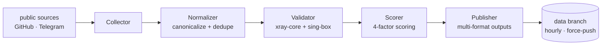

<p align="center">
  
</p>

<p align="center">
  <a href="https://github.com/Edsel-Rahimi/Ariston/stargazers"></a>
  <a href="https://github.com/Edsel-Rahimi/Ariston/actions/workflows/pipeline.yml"></a>
  
  <a href="LICENSE"></a>
</p>

<p align="center">
  <a href="README.md">🇮🇷 فارسی</a> · <b>🇬🇧 English</b> · <a href="README.tr.md">🇹🇷 Türkçe</a> · <a href="README.zh.md">🇨🇳 中文</a> · <a href="README.ru.md">🇷🇺 Русский</a>
</p>

---

# 🏛️ Ariston

> **A continuously-validated pool of healthy network endpoints — refined every hour.**
> *In Ancient Greek, **Ariston** means "the best". That is the whole mission statement.*

<p align="center">
  
</p>

<!-- stats:start -->
| | |
|---|---|
| 🕒 Last run | **2026-10-29 21:39 UTC** |
| 🧹 Cleanup | **17,219 raw → 8,755 unique** |
| 🧪 Live-tested | **8,697 nodes (dual-engine)** |
| ✅ Healthy | **386 (4.4%)** |
| 🏅 Gold / Silver / Bronze | **67 / 260 / 59** |
| ⚡ Median latency | **557.7 ms** |
<!-- stats:end -->

## ⚡ Start here — copy one line

If you only have room for one line, import this — endpoints **proven alive by the latest live sweep**:

```text
# 🥇 best quality — gold tier
https://raw.githubusercontent.com/Edsel-Rahimi/Ariston/data/gold.txt
# ✅ balanced (recommended) — everything healthy this run
https://raw.githubusercontent.com/Edsel-Rahimi/Ariston/data/validated.txt
# 🗂 everything — all unique endpoints
https://raw.githubusercontent.com/Edsel-Rahimi/Ariston/data/nodes.txt
```

**📱 On your phone?** Scan one of these — the QR encodes the subscription URL itself, so your client fetches a fresh list every time:

<p align="center">
  &nbsp;&nbsp;&nbsp;
  &nbsp;&nbsp;&nbsp;
  
</p>

## 🎛️ Tiers — one pool, different amounts of evidence

These files are not different sources. It is the **same deduplicated pool**, filtered by how much evidence of health each endpoint carries:

| Tier | What gets in | Plain | Base64 |
|---|---|:---:|:---:|
| 🥇 **gold** | score ≥ 80 — the fastest, most stable | [txt](https://raw.githubusercontent.com/Edsel-Rahimi/Ariston/data/gold.txt) | [b64](https://raw.githubusercontent.com/Edsel-Rahimi/Ariston/data/gold.b64) |
| 🥈 **silver** | score ≥ 55 — good quality, more variety | [txt](https://raw.githubusercontent.com/Edsel-Rahimi/Ariston/data/silver.txt) | [b64](https://raw.githubusercontent.com/Edsel-Rahimi/Ariston/data/silver.b64) |
| ✅ **validated** | passed the live sweep on this run | [txt](https://raw.githubusercontent.com/Edsel-Rahimi/Ariston/data/validated.txt) | [b64](https://raw.githubusercontent.com/Edsel-Rahimi/Ariston/data/validated.b64) |
| 🗂 **all** | every unique endpoint — untested | [txt](https://raw.githubusercontent.com/Edsel-Rahimi/Ariston/data/nodes.txt) | [b64](https://raw.githubusercontent.com/Edsel-Rahimi/Ariston/data/nodes.b64) |

**Ready-made client configs** (built from live-tested endpoints, best first):

| File | Good for |
|---|---|
| [`mihomo.yaml`](https://raw.githubusercontent.com/Edsel-Rahimi/Ariston/data/mihomo.yaml) | Mihomo · Clash.Meta · Clash Verge — auto-select group of the best |
| [`singbox.json`](https://raw.githubusercontent.com/Edsel-Rahimi/Ariston/data/singbox.json) | sing-box · SFA · SFI — selector + automatic urltest |

<details>
<summary>📎 Quick import guide per app</summary>

- **v2rayNG** → Subscriptions → add the URL of a `.b64` file
- **Hiddify** → New Profile → URL of `validated.txt`
- **NekoBox** → Groups → Add group → URL of `validated.txt`
- **Streisand** → Configs → `+` → URL of `validated.txt`
- **Clash Verge / Mihomo** → Import → URL of `mihomo.yaml`
- **sing-box / SFI / SFA** → Profiles → New → URL of `singbox.json`

</details>

## 🧪 "Does it actually work?" — measured, not estimated

Most repositories show you a big number and let you guess. Ariston does the opposite: **it measures the real number and shows it.** The uncomfortable truth of free endpoints is that at any given moment the majority of any pool is dead — we don't hide that; we measure it every hour and rank by it.

| Stage | The question it asks | Cost |
|---|---|---|
| **L1 normalize** | Is it parsable? Is it unique? Is it routable? | no network |
| **L2 spin-up** | Does the protocol handshake actually answer? | xray-core + sing-box cores |
| **L3 real probe** | Does an HTTP request **through** the endpoint return `204`? | SOCKS5 + `/generate_204` |

> 🧭 **Why two engines?** Because neither sees the whole map: xray-core is blind to QUIC protocols (Hysteria2 / TUIC), while sing-box misses some xray variants. Each engine covers the other's blind spot — a detail most similar projects ignore.

The live numbers for this very moment are in the stats table above; the full history lives in [`results.json`](https://raw.githubusercontent.com/Edsel-Rahimi/Ariston/data/results.json).

## 🇮🇷 Iranian operator split

Endpoints sitting on Iranian networks are published separately — useful for domestic traffic, which is often free and faster. The split is done via ASN ownership tables, not geo guesswork:

| Operator | File | | Operator | File |
|---|---|---|---|---|
| 📡 MCI (Hamrah-e Aval) | [mci](https://raw.githubusercontent.com/Edsel-Rahimi/Ariston/data/by-operator/mci.txt) | | 🌐 Shatel | [shatel](https://raw.githubusercontent.com/Edsel-Rahimi/Ariston/data/by-operator/shatel.txt) |
| 📡 Irancell | [irancell](https://raw.githubusercontent.com/Edsel-Rahimi/Ariston/data/by-operator/irancell.txt) | | 🌐 MobinNet | [mobinnet](https://raw.githubusercontent.com/Edsel-Rahimi/Ariston/data/by-operator/mobinnet.txt) |
| 📡 TCI (Mokhaberat) | [tci](https://raw.githubusercontent.com/Edsel-Rahimi/Ariston/data/by-operator/tci.txt) | | 🌐 Asiatech | [asiatech](https://raw.githubusercontent.com/Edsel-Rahimi/Ariston/data/by-operator/asiatech.txt) |
| 📡 Rightel | [rightel](https://raw.githubusercontent.com/Edsel-Rahimi/Ariston/data/by-operator/rightel.txt) | | 🌐 ParsOnline | [parsonline](https://raw.githubusercontent.com/Edsel-Rahimi/Ariston/data/by-operator/parsonline.txt) |
| 📡 Pishgaman | [pishgaman](https://raw.githubusercontent.com/Edsel-Rahimi/Ariston/data/by-operator/pishgaman.txt) | | 🌐 Respina | [respina](https://raw.githubusercontent.com/Edsel-Rahimi/Ariston/data/by-operator/respina.txt) |
| | | | 🌍 other IR networks | [ir-other](https://raw.githubusercontent.com/Edsel-Rahimi/Ariston/data/by-operator/ir-other.txt) |

> An empty file simply means the last run found no endpoint on that network — not a broken file.

## ⚙️ Supported protocols

| Protocol | Collected | Tested |
|---|:---:|:---:|
| VLESS (incl. Reality / Vision / XHTTP) | ✅ | ✅ |
| VMess | ✅ | ✅ |
| Trojan | ✅ | ✅ |
| Shadowsocks / SS2022 | ✅ | ✅ |
| Hysteria2 | ✅ | ✅ |
| TUIC v5 | ✅ | ✅ |
| SSR | ✅ | — |

## 🏗 Architecture



Full details: [`docs/architecture.md`](docs/architecture.md)

## ➕ Adding a source

Know a new source (a Telegram channel or a public file)? See [`CONTRIBUTING.md`](CONTRIBUTING.md) — a PR editing `pipeline/sources.json` is all it takes.

> ⚠️ **Naming policy:** this project deliberately uses neutral wording ("node", "network endpoint") in file names, texts and code; experience shows repositories that brand themselves with direct names tend to have shorter lifetimes. Please follow the same style in PRs.

## 🗺 Roadmap

- [x] **Phase 1 — MVP:** collect + normalize + dedupe
- [x] **Phase 1b — dual-engine testing:** xray-core + sing-box on GitHub Actions
- [x] **Phase 2 — scoring & clients:** gold/silver/bronze tiers, mihomo.yaml + singbox.json, live stats
- [x] **Phase 3 — operators & notify:** Iranian ASN split, Telegram notification, mirroring
- [ ] **Phase 4 — web dashboard:** a live page on GitHub Pages
- [ ] **Phase 5 — Telegram bot:** fetch the files inside Telegram
- [ ] **Phase 6 — scale:** more sources, multi-region testing

## ❓ FAQ

<details>
<summary><b>Why is only a fraction of the pool alive?</b></summary>

That is the nature of free endpoints — they die or get crowded quickly. The difference is that we **measure and show** this reality instead of baiting you with a raw "tens of thousands of configs" number. The real number refreshes hourly in the stats table above.

</details>

<details>
<summary><b>Which file should I use?</b></summary>

- Beginner or in a hurry → `validated.txt` (balanced, smaller)
- Only the best → `gold.txt`
- Using a specific client → `mihomo.yaml` or `singbox.json`
- Want to explore everything → `nodes.txt`

</details>

<details>
<summary><b>How often is it updated?</b></summary>

Automatically every hour at :07 UTC. The `data` branch always holds exactly one snapshot (force-push); repo history never bloats and links you copy today keep working forever.

</details>

<details>
<summary><b>Why is the wording so neutral?</b></summary>

Experience shows that using direct branding in titles and texts raises the risk of a repository being removed. Ariston merely indexes and refines publicly available data and deliberately describes itself exactly that way — for the project's long-term survival.

</details>

## ⚖️ Disclaimer

This project only **indexes and refines** publicly available data; it provides no service and owns no servers. All data is collected from public sources on the internet and any use is the user's own responsibility. The project is affiliated with no tool or vendor and is offered for research and educational purposes. If you own content and object to it being indexed, open an Issue and it will be removed immediately.

## 📄 License

MIT — see [`LICENSE`](LICENSE)

---

<p align="center">
  If this helped you, give it a ⭐ to keep the repository alive.
</p>
