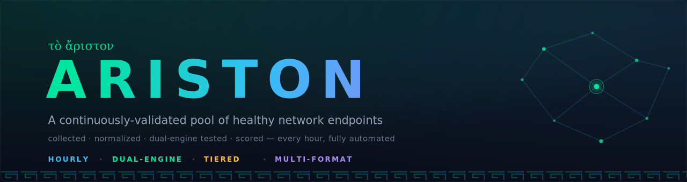
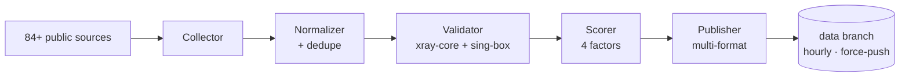

  

  
  
  
  

  🇬🇧 English · <a href="README.md">🇮🇷 فارسی</a>

---

# 🏛️ Ariston

> **A continuously-validated pool of healthy network endpoints — refreshed hourly.**

**Ariston** is an open, data-only pipeline: it aggregates public endpoints from many public sources, canonicalizes them, removes duplicates, and — soon — **health-checks and scores them every hour**, fully automated on GitHub Actions. The output is a set of clean, always-fresh files you can import directly into your favorite clients.

| | |
|---|---|
| ⏱️ **Hourly** | automated collection from public sources |
| 🧹 **Cleaned** | two-level dedupe (exact address + server identity) |
| 🧪 **Dual-engine testing** | xray-core + sing-box — every node is booted and answers `generate_204` |
| 📊 **Scored & tiered** | Gold / Silver / Bronze by latency, success and freshness |
| 🛡️ **Anti-bloat** | the `data` branch is force-pushed; repo history never grows |
| 💸 **$0 infra** | everything runs on GitHub Actions — no servers, no cost |

## Why the name?

In ancient Greek, **Ariston** means *"the best"*. That is the whole mission in one word: build the cleanest, freshest and most transparent data repository of its kind. The common pain with similar repositories: huge files full of dead and duplicated entries, history bloat of tens of thousands of commits, and zero insight into *what actually works*. Ariston is built to fix exactly these three — and its emblem, inspired by flowing water and purification, reflects the idea of clean data, always in motion.

## 📥 Downloads

> Files appear on the `data` branch after the first automated run (within an hour of the first push).

| File | Description | Best for |
|---|---|---|
| [`nodes.txt`](https://raw.githubusercontent.com/Edsel-Rahimi/Ariston/data/nodes.txt) | all unique nodes, one URI per line | Hiddify · NekoBox · Streisand · most clients |
| [`nodes.b64`](https://raw.githubusercontent.com/Edsel-Rahimi/Ariston/data/nodes.b64) | base64 single-file bundle | v2rayNG · V2rayN |
| [`validated.txt`](https://raw.githubusercontent.com/Edsel-Rahimi/Ariston/data/validated.txt) | only nodes that passed a live test right now, best score first | best quality-per-byte |
| [`gold.txt`](https://raw.githubusercontent.com/Edsel-Rahimi/Ariston/data/gold.txt) | Gold tier only (score ≥ 80) — the fastest | when you want just the best |
| [`silver.txt`](https://raw.githubusercontent.com/Edsel-Rahimi/Ariston/data/silver.txt) | Silver tier (score ≥ 55) | more variety, still solid |
| [`by-protocol/…`](https://github.com/Edsel-Rahimi/Ariston/tree/data/by-protocol) | split per protocol | when you only need one type |
| [`stats.json`](https://raw.githubusercontent.com/Edsel-Rahimi/Ariston/data/stats.json) | full stats of the last run | developers |

## ⚙️ Supported protocols

| Protocol | Collect | Test |
|---|:---:|:---:|
| VLESS (incl. Reality / Vision / XHTTP) | ✅ | ✅ |
| VMess | ✅ | ✅ |
| Trojan | ✅ | ✅ |
| Shadowsocks / SS2022 | ✅ | ✅ |
| Hysteria2 | ✅ | ✅ |
| TUIC v5 | ✅ | ✅ |
| SSR | ✅ | — |

Testing uses **two engines** because xray-core cannot handle QUIC-based protocols (Hysteria2 / TUIC) — a blind spot most similar repositories ignore.

## 🏗 Architecture

Full details: [`docs/architecture.md`](docs/architecture.md)

## ➕ Adding a source

Open a PR editing [`pipeline/sources.json`](pipeline/sources.json) — see [`CONTRIBUTING.md`](CONTRIBUTING.md).

> ⚠️ **Naming policy:** this project deliberately uses neutral vocabulary in file names, docs and code. Please keep PRs consistent.

## ⚖️ Disclaimer

This project only **indexes and filters publicly available data**; it provides no service and hosts no servers. All data is aggregated from public sources, and any use is the user's own responsibility. Offered for research and educational purposes only. Rights holders who do not want their data indexed can open an issue and it will be removed immediately.

## 📄 License

MIT — see [`LICENSE`](LICENSE).

---

  If this is useful, a ⭐ helps keep the project alive.

