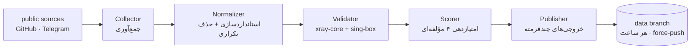

<p align="center">
  
</p>

<p align="center">
  <a href="https://github.com/Edsel-Rahimi/Ariston/stargazers"></a>
  <a href="https://github.com/Edsel-Rahimi/Ariston/actions/workflows/pipeline.yml"></a>
  
  <a href="LICENSE"></a>
</p>

<p align="center">
  <b>🇮🇷 فارسی</b> · <a href="README.en.md">🇬🇧 English</a> · <a href="README.tr.md">🇹🇷 Türkçe</a> · <a href="README.zh.md">🇨🇳 中文</a> · <a href="README.ru.md">🇷🇺 Русский</a>
</p>

---

# 🏛️ آریستون

> **مخزنِ گره‌های سالم — هر ساعت پالایش می‌شود**
> *در یونان باستان **Ariston** یعنی «بهترین»؛ هدف ما هم همین یک کلمه است.*

<p align="center">
  
</p>

<!-- stats:start -->
| | |
|---|---|
| 🕒 آخرین اجرا | **2026-10-30 07:58 UTC** |
| 🧹 پالایش | **98,498 خام ← 30,702 یکتا** |
| 🧪 تست زنده | **13,675 گره دو-موتوره** |
| ✅ سالم | **821 (6.0%)** |
| 🏅 طلا / نقره / برنز | **147 / 584 / 90** |
| ⚡ تأخیر میانه | **589.0 ms** |
<!-- stats:end -->

## ⚡ شروع سریع — یک خط را کپی کن

اگر فقط یک خط جا دارید، همین را import کنید — **گره‌های تاییدشده** که همین اجرای زنده پاس شده‌اند:

```text
# 🥇 بهترین کیفیت — رده‌ی طلا
https://raw.githubusercontent.com/Edsel-Rahimi/Ariston/data/gold.txt
# ✅ متعادل (پیشنهادی) — همه‌ی سالم‌های همین اجرا
https://raw.githubusercontent.com/Edsel-Rahimi/Ariston/data/validated.txt
# 🗂 همه‌چیز — تمام گره‌های یکتا
https://raw.githubusercontent.com/Edsel-Rahimi/Ariston/data/nodes.txt
```

**📱 با گوشی؟** یکی از این کدها را اسکن کنید — خودِ نشانی اشتراک رمزگذاری شده، پس کلاینت شما هر بار فهرست تازه می‌گیرد:

<p align="center">
  &nbsp;&nbsp;&nbsp;
  &nbsp;&nbsp;&nbsp;
  
</p>

## 🎛️ رده‌ها — همان استخر، با میزان متفاوتی از شواهد

این فایل‌ها منابع متفاوتی نیستند؛ **همان استخرِ یکتا** هستند که با «چقدر شواهد سلامت» فیلتر شده‌اند:

| رده | چه چیزی داخلش است | متنی | Base64 |
|---|---|:---:|:---:|
| 🥇 **gold** | امتیاز ≥ ۸۰ — سریع‌ترین و پایدارترین‌ها | [txt](https://raw.githubusercontent.com/Edsel-Rahimi/Ariston/data/gold.txt) | [b64](https://raw.githubusercontent.com/Edsel-Rahimi/Ariston/data/gold.b64) |
| 🥈 **silver** | امتیاز ≥ ۵۵ — کیفیت خوب با تنوع بیشتر | [txt](https://raw.githubusercontent.com/Edsel-Rahimi/Ariston/data/silver.txt) | [b64](https://raw.githubusercontent.com/Edsel-Rahimi/Ariston/data/silver.b64) |
| ✅ **validated** | همین اجرا تست زنده را پاس کردند | [txt](https://raw.githubusercontent.com/Edsel-Rahimi/Ariston/data/validated.txt) | [b64](https://raw.githubusercontent.com/Edsel-Rahimi/Ariston/data/validated.b64) |
| 🗂 **all** | همه‌ی گره‌های یکتا — بدون تست | [txt](https://raw.githubusercontent.com/Edsel-Rahimi/Ariston/data/nodes.txt) | [b64](https://raw.githubusercontent.com/Edsel-Rahimi/Ariston/data/nodes.b64) |

**پیکربندی آماده‌ی کلاینت** (ساخته‌شده از گره‌های زنده، بهترین اول):

| فایل | مناسب برای |
|---|---|
| [`mihomo.yaml`](https://raw.githubusercontent.com/Edsel-Rahimi/Ariston/data/mihomo.yaml) | Mihomo · Clash.Meta · Clash Verge — با گروه انتخاب خودکارِ بهترین‌ها |
| [`singbox.json`](https://raw.githubusercontent.com/Edsel-Rahimi/Ariston/data/singbox.json) | sing-box · SFA · SFI — سلکتور + تست خودکار |

<details>
<summary>📎 راهنمای سریع import در اپ‌ها</summary>

- **v2rayNG** → Subscriptions → URL فایل `.b64` را اضافه کنید
- **Hiddify** → New Profile → URL فایل `validated.txt`
- **NekoBox** → Groups → Add group → URL فایل `validated.txt`
- **Streisand** → Configs → `+` → URL فایل `validated.txt`
- **Clash Verge / Mihomo** → Import → URL فایل `mihomo.yaml`
- **sing-box / SFI / SFA** → Profiles → New → URL فایل `singbox.json`

</details>

## 🧪 «واقعاً کار می‌کند؟» — جوابِ اندازه‌گرفته‌شده

اکثر مخازن یک عدد بزرگ نشان می‌دهند و شما را حدس زدن رها می‌کنند. آریستون برعکس عمل می‌کند: **عدد واقعی را می‌سنجد و نشان می‌دهد.** واقعیتِ تلخِ کانفیگ رایگان این است که در هر لحظه، بیشترِ استخر مرده است — ما این را پنهان نمی‌کنیم، هر ساعت اندازه می‌گیریم و بر اساس آن رتبه می‌دهیم.

| مرحله | چه سؤالی می‌پرسد | هزینه |
|---|---|---|
| **L1 استانداردسازی** | قابل تحلیل است؟ یکتاست؟ مسیر شبکه‌ای دارد؟ | بدون شبکه |
| **L2 راه‌اندازی** | هندشیکِ پروتکل واقعاً جواب می‌دهد؟ | هسته‌ی xray + sing-box |
| **L3 پروب واقعی** | درخواست HTTP از **میانِ** گره، جواب `204` می‌گیرد؟ | SOCKS5 + `/generate_204` |

> 🧭 **چرا دو موتور؟** چون هیچ‌کدام نقشه‌ی کامل ندارد: xray-core پروتکل‌های QUIC (Hysteria2 / TUIC) را نمی‌بیند و sing-box برخی گونه‌های xray را. کور‌نقطه‌ی هر موتور با دیگری پر می‌شود — چیزی که اکثر مخازن مشابه نادیده می‌گیرند.

عدد زنده‌ی همین لحظه در جدول آمار بالا است؛ تاریخچه‌ی کامل در [`results.json`](https://raw.githubusercontent.com/Edsel-Rahimi/Ariston/data/results.json).

## 🇮🇷 تفکیک اپراتورهای ایران

گره‌هایی که روی شبکه‌های ایرانی قرار دارند جدا منتشر می‌شوند — برای ترافیک داخلی که اغلب رایگان‌تر و سریع‌تر است. این تفکیک با جدول ASN (متعلق به شبکه) انجام می‌شود، نه حدس جغرافیایی:

| شبکه | فایل | | شبکه | فایل |
|---|---|---|---|---|
| 📡 همراه اول | [mci](https://raw.githubusercontent.com/Edsel-Rahimi/Ariston/data/by-operator/mci.txt) | | 🌐 شاتل | [shatel](https://raw.githubusercontent.com/Edsel-Rahimi/Ariston/data/by-operator/shatel.txt) |
| 📡 ایرانسل | [irancell](https://raw.githubusercontent.com/Edsel-Rahimi/Ariston/data/by-operator/irancell.txt) | | 🌐 مبین‌نت | [mobinnet](https://raw.githubusercontent.com/Edsel-Rahimi/Ariston/data/by-operator/mobinnet.txt) |
| 📡 مخابرات | [tci](https://raw.githubusercontent.com/Edsel-Rahimi/Ariston/data/by-operator/tci.txt) | | 🌐 آسیاتک | [asiatech](https://raw.githubusercontent.com/Edsel-Rahimi/Ariston/data/by-operator/asiatech.txt) |
| 📡 رایتل | [rightel](https://raw.githubusercontent.com/Edsel-Rahimi/Ariston/data/by-operator/rightel.txt) | | 🌐 پارس‌آنلاین | [parsonline](https://raw.githubusercontent.com/Edsel-Rahimi/Ariston/data/by-operator/parsonline.txt) |
| 📡 پیشگامان | [pishgaman](https://raw.githubusercontent.com/Edsel-Rahimi/Ariston/data/by-operator/pishgaman.txt) | | 🌐 رسپینا | [respina](https://raw.githubusercontent.com/Edsel-Rahimi/Ariston/data/by-operator/respina.txt) |
| | | | 🌍 سایر شبکه‌های ایران | [ir-other](https://raw.githubusercontent.com/Edsel-Rahimi/Ariston/data/by-operator/ir-other.txt) |

> فایل خالی یعنی در آخرین اجرا گره‌ای روی آن شبکه نبود — نه اینکه فایل خراب است.

## ⚙️ پروتکل‌های پشتیبانی‌شده

| پروتکل | جمع‌آوری | تست |
|---|:---:|:---:|
| VLESS (شامل Reality / Vision / XHTTP) | ✅ | ✅ |
| VMess | ✅ | ✅ |
| Trojan | ✅ | ✅ |
| Shadowsocks / SS2022 | ✅ | ✅ |
| Hysteria2 | ✅ | ✅ |
| TUIC v5 | ✅ | ✅ |
| SSR | ✅ | — |

## 🏗 معماری



جزئیات کامل: [`docs/architecture.md`](docs/architecture.md)

## ➕ افزودن منبع

منبع جدید (کانال تلگرام یا فایل عمومی) دارید؟ [`CONTRIBUTING.md`](CONTRIBUTING.md) را ببینید — یک PR با ویرایش `pipeline/sources.json` کافی است.

> ⚠️ **سیاست نام‌گذاری:** این پروژه عمداً از واژه‌های خنثی («گره»، «نقطه‌ی شبکه») در نام فایل‌ها، متون و کد استفاده می‌کند؛ تجربه نشان داده مخازنی که با نام‌های مستقیم فعالیت می‌کنند عمر کوتاه‌تری دارند. لطفاً PR ها هم همین‌طور بنویسند.

## 🗺 نقشه‌ی راه

- [x] **فاز ۱ — MVP:** جمع‌آوری + استانداردسازی + حذف تکراری
- [x] **فاز ۱ب — تست دو-موتوره:** xray-core + sing-box در GitHub Actions
- [x] **فاز ۲ — امتیاز و کلاینت‌ها:** رده‌بندی طلا/نقره/برنز، mihomo.yaml و singbox.json، آمار زنده
- [x] **فاز ۳ — اپراتورها و اعلان:** تفکیک ASN ایران، اعلان تلگرام، آینه‌سازی
- [ ] **فاز ۴ — وب‌داشبورد:** صفحه‌ی زنده روی GitHub Pages
- [ ] **فاز ۵ — بات تلگرام:** دریافت فایل‌ها داخل تلگرام
- [ ] **فاز ۶ — مقیاس:** گسترش منابع، تست چند-منطقه‌ای

## ❓ پرسش‌های پرتکرار

<details>
<summary><b>چرا از این همه گره، فقط این تعداد زنده است؟</b></summary>

طبیعتِ کانفیگ رایگان همین است — گره‌ها به‌سرعت می‌میرند یا شلوغ می‌شوند. تفاوت ما این است که این واقعیت را **می‌سنجیم و نشان می‌دهیم** به‌جای اینکه با نمایش عدد خامِ «ده‌ها هزار کانفیگ» شما را گمراه کنیم. عدد واقعی هر ساعت در جدول آمار همین صفحه به‌روز می‌شود.

</details>

<details>
<summary><b>کدام فایل برای من مناسب است؟</b></summary>

- تازه‌کار یا حوصله ندارید → `validated.txt` (متعادل و کم‌حجم‌تر)
- فقط بهترین‌ها → `gold.txt`
- اپ خاصی دارید → `mihomo.yaml` یا `singbox.json`
- می‌خواهید خودتان بگردید → `nodes.txt`

</details>

<details>
<summary><b>هر چند وقت به‌روز می‌شود؟</b></summary>

هر ساعت رأس :07 به‌وقت UTC به‌صورت خودکار. شاخه‌ی `data` همیشه دقیقاً یک snapshot دارد (force-push)؛ تاریخچه‌ی مخزن هرگز باد نمی‌کند و لینک‌هایی که امروز کپی می‌کنید همیشه معتبر می‌مانند.

</details>

<details>
<summary><b>چرا نام فایل‌ها و متون این‌قدر خنثی است؟</b></summary>

تجربه‌ی مخازن مشابه نشان داده که استفاده از نام‌های مستقیم در عنوان و متن، ریسک حذف مخزن را بالا می‌برد. آریستون صرفاً داده‌ی عمومی را ایندکس و پالایش می‌کند و عمداً همین‌طور معرفی می‌شود — برای ماندگاری بلندمدت پروژه.

</details>

## ⚖️ سلب مسئولیت

این پروژه صرفاً داده‌های عمومی را **ایندکس و پالایش** می‌کند؛ هیچ سرویسی ارائه نمی‌دهد و هیچ سروری در اختیار ندارد. تمام داده‌ها از منابع عمومی اینترنت گردآوری شده‌اند و مسئولیت هرگونه استفاده با کاربر است. این پروژه با هیچ ابزار یا سازنده‌ای وابستگی ندارد و صرفاً برای پژوهش و آموزش عرضه می‌شود. اگر مالک محتوایی هستید و مخالف ایندکس‌شدن داده‌تان هستید، یک Issue باز کنید تا فوراً حذف شود.

## 📄 مجوز

MIT — جزئیات در [`LICENSE`](LICENSE)

---

<p align="center">
  اگر مفید بود، یک ⭐ بدهید تا مخزن پایدار بماند.
</p>
