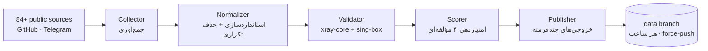

  

  
  
  
  

  <a href="README.en.md">🇬🇧 English</a> · <a href="#چرا-آریستون">🇮🇷 درباره‌ی پروژه</a>

---

# 🏛️ آریستون

> **مخزنِ گره‌های سالم — هر ساعت پالایش می‌شود**
> *A continuously-validated pool of healthy network endpoints*

**آریستون** یک پروژه‌ی داده‌ای و متن‌باز است: گره‌های عمومیِ منتشرشده در منابع مختلف را جمع‌آوری، استانداردسازی، حذف تکراری و هر ساعت به‌صورت خودکار **تستِ زنده و امتیازدهی** می‌کند. خروجی، فایل‌هایی تمیز و همیشه‌تازه در چند فرمت است که مستقیم داخل اپ‌های محبوب شما import می‌شود.

| | |
|---|---|
| ⏱️ **هر ساعت** | جمع‌آوری خودکار از منابع عمومی |
| 🧹 **پالایش** | حذف تکراری‌ها در دو سطح (آدرس کامل + هویت سرور) |
| 🧪 **تست دو-موتوره** | xray-core + sing-box — هر گره واقعاً بالا می‌آید و `generate_204` جواب می‌گیرد |
| 📊 **امتیاز و رده** | Gold / Silver / Bronze بر اساس تأخیر، موفقیت و تازگی |
| 🛡️ **ضد تاریخی‌شدن** | شاخه‌ی `data` هر بار force-push می‌شود؛ تاریخچه‌ی ریپو هرگز باد نمی‌کند |
| 🇮🇷 **تفکیک اپراتور** | گره‌های روی شبکه‌های ایرانی به تفکیک همراه اول، ایرانسل، مخابرات و… |
| 📣 **اعلان و آینه** | خلاصه‌ی تلگرامی و آینه‌سازی — با یک Secret فعال می‌شود |
| 💸 **صفر تومن** | تمام زیرساخت روی GitHub Actions — بدون سرور، بدون هزینه |

<!-- stats:start -->
| | |
|---|---|
| 🕒 آخرین اجرا | اولین اجرا در راه است… |
| 🧪 تست زنده | دو موتور xray + sing-box، هر ساعت |
| 🏅 رده‌بندی | طلا / نقره / برنز |
<!-- stats:end -->

## 🧭 چرا آریستون؟

در یونان باستان، **Ariston** یعنی «بهترین». هدف همین یک کلمه است: ساختن **بهترین** مخزن داده‌ای در نوع خودش — تمیزتر، تازه‌تر و شفاف‌تر از هر چیز موجود.

مشکل بزرگ مخازن مشابه: فایل‌های حجیمِ پر از تکراری و مرده، تاریخچه‌ی ده‌ها هزار کامیت، و هیچ اطلاعی از «کدام گره واقعاً کار می‌کند». آریستون برای حل همین سه درد ساخته شد — و آرم آن نیز از نماد آب و پالایش الهام گرفته است: داده‌ی تمیز، همیشه در جریان.

## 📥 دریافت فایل‌ها

> فایل‌ها پس از اولین اجرای خودکار (حداکثر ۱ ساعت پس از اولین push) روی شاخه‌ی `data` ساخته می‌شوند.

| فایل | توضیح | مناسب برای |
|---|---|---|
| [`nodes.txt`](https://raw.githubusercontent.com/Edsel-Rahimi/Ariston/data/nodes.txt) | همه‌ی گره‌های یکتا — هر خط یک آدرس | Hiddify · NekoBox · Streisand · اکثر اپ‌ها |
| [`nodes.b64`](https://raw.githubusercontent.com/Edsel-Rahimi/Ariston/data/nodes.b64) | نسخه‌ی base64 یکجا | v2rayNG · V2rayN |
| [`validated.txt`](https://raw.githubusercontent.com/Edsel-Rahimi/Ariston/data/validated.txt) | فقط گره‌هایی که همین حالا تست زنده را پاس کردند — مرتب بر اساس امتیاز | بهترین نسبت کیفیت به حجم |
| [`gold.txt`](https://raw.githubusercontent.com/Edsel-Rahimi/Ariston/data/gold.txt) | فقط رده‌ی Gold (امتیاز ≥ ۸۰) — سریع‌ترین‌ها | وقتی فقط بهترین‌ها را می‌خواهید |
| [`silver.txt`](https://raw.githubusercontent.com/Edsel-Rahimi/Ariston/data/silver.txt) | رده‌ی Silver (امتیاز ≥ ۵۵) | تنوع بیشتر با کیفیت خوب |
| [`mihomo.yaml`](https://raw.githubusercontent.com/Edsel-Rahimi/Ariston/data/mihomo.yaml) | پیکربندی کامل آماده‌ی Mihomo (Clash.Meta) — گروه خودکارِ بهترین‌ها | Mihomo · Clash.Meta · Clash Verge |
| [`singbox.json`](https://raw.githubusercontent.com/Edsel-Rahimi/Ariston/data/singbox.json) | پیکربندی کامل آماده‌ی sing-box — سلکتور + انتخابگر خودکار | SFA · SFI · sing-box دسکتاپ |
| [`by-protocol/…`](https://github.com/Edsel-Rahimi/Ariston/tree/data/by-protocol) | جدا شده بر اساس پروتکل | وقتی فقط یک نوع می‌خواهید |
| [`by-operator/…`](https://github.com/Edsel-Rahimi/Ariston/tree/data/by-operator) | گره‌های روی شبکه‌های ایرانی به تفکیک اپراتور | ترافیک داخلی — اغلب رایگان و سریع‌تر |
| [`stats.json`](https://raw.githubusercontent.com/Edsel-Rahimi/Ariston/data/stats.json) | آمار کامل آخرین اجرا | توسعه‌دهنده‌ها |

📎 راهنمای سریع import در اپ‌ها

- **v2rayNG** → بخش Subscriptions → URL فایل `.b64` را اضافه کنید
- **Hiddify** → New Profile → URL فایل `nodes.txt`
- **NekoBox** → Groups → Add group → URL فایل `nodes.txt`
- **Streisand** → Configs → `+` → URL فایل `nodes.txt`

## ⚙️ پروتکل‌های پشتیبانی‌شده

| پروتکل | جمع‌آوری | تست |
|---|:---:|:---:|
| VLESS (شامل Reality / Vision / XHTTP) | ✅ | ✅ |
| VMess | ✅ | ✅ |
| Trojan | ✅ | ✅ |
| Shadowsocks / SS2022 | ✅ | ✅ |
| Hysteria2 | ✅ | ✅ |
| TUIC v5 | ✅ | ✅ |
| SSR | ✅ | — |

تست با **دو موتور** انجام می‌شود، چون xray-core پروتکل‌های QUIC (Hysteria2 / TUIC) را پشتیبانی نمی‌کند — نقطه‌ی کوری که اکثر مخازن مشابه نادیده می‌گیرند.

## 🏗 معماری

جزئیات کامل: [`docs/architecture.md`](docs/architecture.md)

## 📊 آخرین وضعیت

آمار زنده به‌زودی به‌صورت خودکار همین‌جا به‌روز می‌شود — فعلاً [`stats.json`](https://raw.githubusercontent.com/Edsel-Rahimi/Ariston/data/stats.json) را ببینید.

## ➕ افزودن منبع

منبع جدید (کانال تلگرام یا فایل عمومی) دارید؟ [`CONTRIBUTING.md`](CONTRIBUTING.md) را ببینید — یک PR با ویرایش `pipeline/sources.json` کافی است.

> ⚠️ **سیاست نام‌گذاری:** این پروژه عمداً از واژه‌های خنثی در نام فایل‌ها، متون و کد استفاده می‌کند. لطفاً PR ها هم همین‌طور بنویسند.

## 🗺 نقشه‌ی راه

- [x] **فاز ۱ — MVP:** جمع‌آوری + استانداردسازی + حذف تکراری (همین نسخه)
- [ ] **فاز ۱ب:** موتور تست دو-موتوره (xray-core + sing-box) در GitHub Actions
- [ ] **فاز ۲:** امتیازدهی، رده‌بندی Gold/Silver/Bronze، خروجی Clash.Meta و sing-box، README زنده
- [ ] **فاز ۳:** Bot تلگرام، میرور GitLab/Codeberg، تفکیک بر اساس اپراتور
- [ ] **فاز ۴:** API داینامیک، تست از نقاط متعدد

## ⚖️ سلب مسئولیت

این پروژه صرفاً داده‌های عمومی را **ایندکس و پالایش** می‌کند؛ هیچ سرویسی ارائه نمی‌دهد و هیچ سروری در اختیار ندارد. تمام داده‌ها از منابع عمومی اینترنت گردآوری شده‌اند و مسئولیت هرگونه استفاده با کاربر است. این پروژه با هیچ ابزار یا سازنده‌ای وابستگی ندارد و صرفاً برای پژوهش و آموزش عرضه می‌شود. اگر مالک محتوایی هستید و مخالف ایندکس‌شدن داده‌تان هستید، یک Issue باز کنید تا فوراً حذف شود.

## 📄 مجوز

MIT — جزئیات در [`LICENSE`](LICENSE)

---

  اگر مفید بود، یک ⭐ بدهید تا مخزن پایدار بماند.

