<p align="center">
  <picture><source media="(prefers-color-scheme: dark)" srcset="assets/dark/banner.svg"></picture>
</p>

<p align="center">
  <a href="https://github.com/Edsel-Rahimi/Ariston/stargazers"></a>
  <a href="https://github.com/Edsel-Rahimi/Ariston/actions/workflows/pipeline.yml"></a>
  
  <a href="LICENSE"></a>
</p>

<p align="center">
  <a href="README.md"><picture><source media="(prefers-color-scheme: dark)" srcset="assets/dark/lang-fa.svg"></picture></a>&nbsp;
  <a href="README.md"><picture><source media="(prefers-color-scheme: dark)" srcset="assets/dark/lang-en.svg"></picture></a>&nbsp;
  <a href="README.tr.md"><picture><source media="(prefers-color-scheme: dark)" srcset="assets/dark/lang-tr.svg"></picture></a>&nbsp;
  <a href="README.ru.md"><picture><source media="(prefers-color-scheme: dark)" srcset="assets/dark/lang-ru-on.svg"></picture></a>&nbsp;
  <a href="README.zh.md"><picture><source media="(prefers-color-scheme: dark)" srcset="assets/dark/lang-zh.svg"></picture></a>
</p>

> **Репозиторий живых узлов — фильтруется каждые 30 минут.** В древнегреческом **Ariston** значит “лучшее”; в этом и есть вся цель. Числа на карточке ниже построены из последнего реального запуска — без рекламной арифметики.

<p align="center">
  <picture><source media="(prefers-color-scheme: dark)" srcset="assets/dark/run-card.svg"></picture>
</p>

## Quick start

<p align="center">
  <picture><source media="(prefers-color-scheme: dark)" srcset="assets/dark/quickstart.svg"></picture>
</p>

Место только на одну строку? Импортируйте это:

```text
# best quality — gold tier
https://raw.githubusercontent.com/Edsel-Rahimi/Ariston/data/gold.txt
# balanced (recommended) — everything healthy this run
https://raw.githubusercontent.com/Edsel-Rahimi/Ariston/data/validated.txt
# everything — the full unique pool
https://raw.githubusercontent.com/Edsel-Rahimi/Ariston/data/nodes.txt
```

**С телефона?** Отсканируйте один из кодов:

<p align="center">
  &nbsp;&nbsp;&nbsp;
  &nbsp;&nbsp;&nbsp;
  
</p>

## Tiers — text & Base64, one click

Это не разные источники; это **единый уникальный пул**, отфильтрованный по количеству свидетельств здоровья каждого узла. Нажмите на карточку или кнопку:

<p align="center">
  <a href="https://raw.githubusercontent.com/Edsel-Rahimi/Ariston/data/gold.txt"><picture><source media="(prefers-color-scheme: dark)" srcset="assets/dark/tier-gold.svg"></picture></a>
  <a href="https://raw.githubusercontent.com/Edsel-Rahimi/Ariston/data/gold.txt"><picture><source media="(prefers-color-scheme: dark)" srcset="assets/dark/btn-text.svg"></picture></a>
  <a href="https://raw.githubusercontent.com/Edsel-Rahimi/Ariston/data/gold.b64"><picture><source media="(prefers-color-scheme: dark)" srcset="assets/dark/btn-b64.svg"></picture></a>
</p>

<p align="center">
  <a href="https://raw.githubusercontent.com/Edsel-Rahimi/Ariston/data/silver.txt"><picture><source media="(prefers-color-scheme: dark)" srcset="assets/dark/tier-silver.svg"></picture></a>
  <a href="https://raw.githubusercontent.com/Edsel-Rahimi/Ariston/data/silver.txt"><picture><source media="(prefers-color-scheme: dark)" srcset="assets/dark/btn-text.svg"></picture></a>
  <a href="https://raw.githubusercontent.com/Edsel-Rahimi/Ariston/data/silver.b64"><picture><source media="(prefers-color-scheme: dark)" srcset="assets/dark/btn-b64.svg"></picture></a>
</p>

<p align="center">
  <a href="https://raw.githubusercontent.com/Edsel-Rahimi/Ariston/data/validated.txt"><picture><source media="(prefers-color-scheme: dark)" srcset="assets/dark/tier-validated.svg"></picture></a>
  <a href="https://raw.githubusercontent.com/Edsel-Rahimi/Ariston/data/validated.txt"><picture><source media="(prefers-color-scheme: dark)" srcset="assets/dark/btn-text.svg"></picture></a>
  <a href="https://raw.githubusercontent.com/Edsel-Rahimi/Ariston/data/validated.b64"><picture><source media="(prefers-color-scheme: dark)" srcset="assets/dark/btn-b64.svg"></picture></a>
</p>

<p align="center">
  <a href="https://raw.githubusercontent.com/Edsel-Rahimi/Ariston/data/all.txt"><picture><source media="(prefers-color-scheme: dark)" srcset="assets/dark/tier-all.svg"></picture></a>
  <a href="https://raw.githubusercontent.com/Edsel-Rahimi/Ariston/data/all.txt"><picture><source media="(prefers-color-scheme: dark)" srcset="assets/dark/btn-text.svg"></picture></a>
  <a href="https://raw.githubusercontent.com/Edsel-Rahimi/Ariston/data/all.b64"><picture><source media="(prefers-color-scheme: dark)" srcset="assets/dark/btn-b64.svg"></picture></a>
</p>

## Ready-made client configs

Собраны из живых узлов последнего запуска, лучшие впереди — нажмите на карточку, чтобы открыть файл:

<p align="center">
  <a href="https://raw.githubusercontent.com/Edsel-Rahimi/Ariston/data/mihomo.yaml"><picture><source media="(prefers-color-scheme: dark)" srcset="assets/dark/client-mihomo.svg"></picture></a>&nbsp;
  <a href="https://raw.githubusercontent.com/Edsel-Rahimi/Ariston/data/singbox.json"><picture><source media="(prefers-color-scheme: dark)" srcset="assets/dark/client-singbox.svg"></picture></a>
</p>

<details>
<summary>📎 Import guide</summary>

- **v2rayNG** → Subscriptions → add the `.b64` URL
- **Hiddify** → New Profile → `validated.txt` URL
- **NekoBox** → Groups → Add group → `validated.txt` URL
- **Streisand** → Configs → `+` → `validated.txt` URL
- **Clash Verge / Mihomo** → Import → `mihomo.yaml` URL
- **sing-box / SFA / SFI** → Profiles → New → `singbox.json` URL

</details>

## "Does it actually work?" — measured, not estimated

<p align="center">
  <picture><source media="(prefers-color-scheme: dark)" srcset="assets/dark/proof.svg"></picture>
</p>

Большинство репозиториев показывают большое число и оставляют вас с догадками. Ariston поступает наоборот: **измеряет и показывает реальное число.** История каждого узла — в [`results.json`](https://raw.githubusercontent.com/Edsel-Rahimi/Ariston/data/results.json); карточка выше обновляется ежечасно.

И вот полный путь одного запуска — от собранного сырого объёма до золотого уровня. Столбцы в масштабе квадратного корня, чтобы воронка была видна; числа настоящие:

<p align="center">
  <picture><source media="(prefers-color-scheme: dark)" srcset="assets/dark/funnel.svg"></picture>
</p>

## Iranian operator split

Узлы, чьи IP принадлежат иранским сетям, публикуются отдельно — для внутреннего трафика, который часто бесплатнее и быстрее. Разделение по таблице ASN (владелец сети), а не по гео-догадкам. **Нажмите на карточку, чтобы открыть файл сети:**

<p align="center">
  <a href="https://raw.githubusercontent.com/Edsel-Rahimi/Ariston/data/by-operator/irancell.txt"><picture><source media="(prefers-color-scheme: dark)" srcset="assets/dark/op-irancell.svg"></picture></a>
  <a href="https://raw.githubusercontent.com/Edsel-Rahimi/Ariston/data/by-operator/mci.txt"><picture><source media="(prefers-color-scheme: dark)" srcset="assets/dark/op-mci.svg"></picture></a>
  <a href="https://raw.githubusercontent.com/Edsel-Rahimi/Ariston/data/by-operator/tci.txt"><picture><source media="(prefers-color-scheme: dark)" srcset="assets/dark/op-tci.svg"></picture></a>
  <a href="https://raw.githubusercontent.com/Edsel-Rahimi/Ariston/data/by-operator/rightel.txt"><picture><source media="(prefers-color-scheme: dark)" srcset="assets/dark/op-rightel.svg"></picture></a>
  <a href="https://raw.githubusercontent.com/Edsel-Rahimi/Ariston/data/by-operator/pishgaman.txt"><picture><source media="(prefers-color-scheme: dark)" srcset="assets/dark/op-pishgaman.svg"></picture></a>
  <a href="https://raw.githubusercontent.com/Edsel-Rahimi/Ariston/data/by-operator/shatel.txt"><picture><source media="(prefers-color-scheme: dark)" srcset="assets/dark/op-shatel.svg"></picture></a>
  <a href="https://raw.githubusercontent.com/Edsel-Rahimi/Ariston/data/by-operator/mobinnet.txt"><picture><source media="(prefers-color-scheme: dark)" srcset="assets/dark/op-mobinnet.svg"></picture></a>
  <a href="https://raw.githubusercontent.com/Edsel-Rahimi/Ariston/data/by-operator/asiatech.txt"><picture><source media="(prefers-color-scheme: dark)" srcset="assets/dark/op-asiatech.svg"></picture></a>
  <a href="https://raw.githubusercontent.com/Edsel-Rahimi/Ariston/data/by-operator/parsonline.txt"><picture><source media="(prefers-color-scheme: dark)" srcset="assets/dark/op-parsonline.svg"></picture></a>
  <a href="https://raw.githubusercontent.com/Edsel-Rahimi/Ariston/data/by-operator/respina.txt"><picture><source media="(prefers-color-scheme: dark)" srcset="assets/dark/op-respina.svg"></picture></a>
  <a href="https://raw.githubusercontent.com/Edsel-Rahimi/Ariston/data/by-operator/ir-other.txt"><picture><source media="(prefers-color-scheme: dark)" srcset="assets/dark/op-ir-other.svg"></picture></a>
</p>

> Пустой файл означает, что в последнем запуске узлов этой сети не нашлось — файл не сломан.

## Supported protocols

<p align="center">
  <picture><source media="(prefers-color-scheme: dark)" srcset="assets/dark/donut.svg"></picture>
</p>

Реальная доля каждого протокола в последнем запуске — прямо из stats.json:

<p align="center">
  <picture><source media="(prefers-color-scheme: dark)" srcset="assets/dark/protocols.svg"></picture>
</p>

## Architecture

<p align="center">
  <picture><source media="(prefers-color-scheme: dark)" srcset="assets/dark/architecture.svg"></picture>
</p>

Every station in detail: [`docs/architecture.md`](docs/architecture.md)

## Adding a source

Есть новый источник (Telegram-канал или публичный файл)? Смотрите [`CONTRIBUTING.md`](CONTRIBUTING.md) — достаточно одного PR с правкой `pipeline/sources.json`.

> ⚠️ **Политика именования:** проект намеренно использует нейтральные слова (“узел”, “сетевая точка”) в именах файлов, текстах и коде; опыт показывает, что репозитории с прямыми названиями живут меньше. Пожалуйста, держите PR нейтральными.

## Roadmap

- [x] **Фаза 1 — MVP: сбор + нормализация + дедупликация**
- [x] **Фаза 1b — двух-двигательный тест: xray-core + sing-box в GitHub Actions**
- [x] **Фаза 2 — скоринг и клиенты: золото/серебро/бронза, mihomo.yaml, singbox.json**
- [x] **Фаза 3 — операторы и уведомления: ASN-разбивка Ирана, Telegram-уведомления, зеркала**
- [ ] **Фаза 4 — веб-панель: живая страница на GitHub Pages**
- [ ] **Фаза 5 — Telegram-бот: получение файлов внутри Telegram**

## FAQ

<details>
<summary><b>Почему живых узлов так мало?</b></summary>

Такова природа бесплатных конфигов — узлы быстро умирают или перегружаются. Разница в том, что мы это **измеряем и показываем**, а не ослепляем вас сырым числом “десятки тысяч конфигов”. Реальное число обновляется ежечасно на карточке.

</details>

<details>
<summary><b>Какой файл мне подходит?</b></summary>

Новичок или некогда → `validated.txt` · только лучшее → `gold.txt` · конкретное приложение → `mihomo.yaml` / `singbox.json` · покопаться самому → `nodes.txt`

</details>

<details>
<summary><b>Как часто обновляется?</b></summary>

Автоматически каждые 30 минут, в :07 и :37 UTC. Ветка `data` всегда хранит ровно один снимок; ссылки, скопированные сегодня, остаются действительными.

</details>

<details>
<summary><b>Почему формулировки такие нейтральные?</b></summary>

Известно, что прямые названия повышают риск удаления. Ariston лишь индексирует и фильтрует публичные данные — с расчётом на долгую жизнь.

</details>

## Disclaimer

Проект только **индексирует и фильтрует** публичные данные; услуг не оказывает, серверов не держит. Ответственность за использование — на пользователе. Владелец контента? Откройте issue — удалим немедленно.

## License

MIT — see [`LICENSE`](LICENSE)

---

<p align="center">
  Если оказалось полезным — поставьте ⭐, чтобы репозиторий жил.
</p>
