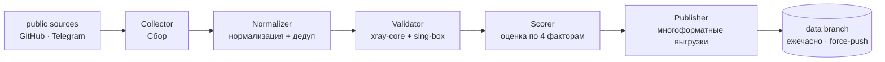

<p align="center">
  
</p>

<p align="center">
  <a href="https://github.com/Edsel-Rahimi/Ariston/stargazers"></a>
  <a href="https://github.com/Edsel-Rahimi/Ariston/actions/workflows/pipeline.yml"></a>
  
  <a href="LICENSE"></a>
</p>

<p align="center">
  <a href="README.md">🇮🇷 فارسی</a> · <a href="README.en.md">🇬🇧 English</a> · <a href="README.tr.md">🇹🇷 Türkçe</a> · <a href="README.zh.md">🇨🇳 中文</a> · <b>🇷🇺 Русский</b>
</p>

---

# 🏛️ Ariston

> **Тонко очищаемый, непрерывно проверяемый пул исправных сетевых узлов — каждый час.**
> *На древнегреческом **Ariston** означает «лучшее». В этом вся миссия проекта.*

<p align="center">
  
</p>

<!-- stats:start -->
| | |
|---|---|
| 🕒 Последний запуск | **2026-10-29 22:39 UTC** |
| 🧹 Очистка | **58,693 сырых → 14,308 уникальных** |
| 🧪 Живая проверка | **5,379 узлов (два движка)** |
| ✅ Работают | **824 (15.3%)** |
| 🏅 Золото / Серебро / Бронза | **84 / 657 / 83** |
| ⚡ Медианная задержка | **574.9 ms** |
<!-- stats:end -->

## ⚡ Быстрый старт — скопируйте одну строку

Если есть место лишь для одной строки, импортируйте эту — узлы, **проверенные живым тестом последнего запуска**:

```text
# 🥇 лучшее качество — уровень золота
https://raw.githubusercontent.com/Edsel-Rahimi/Ariston/data/gold.txt
# ✅ сбалансированный (рекомендуется) — все рабочие этого запуска
https://raw.githubusercontent.com/Edsel-Rahimi/Ariston/data/validated.txt
# 🗂 всё — все уникальные узлы
https://raw.githubusercontent.com/Edsel-Rahimi/Ariston/data/nodes.txt
```

**📱 С телефона?** Отсканируйте один из кодов — QR кодирует сам URL подписки, поэтому клиент каждый раз получает свежий список:

<p align="center">
  &nbsp;&nbsp;&nbsp;
  &nbsp;&nbsp;&nbsp;
  
</p>

## 🎛️ Уровни — один пул, разное количество доказательств

Эти файлы — не разные источники. Это **тот же дедуплицированный пул**, отфильтрованный по количеству доказательств работоспособности каждого узла:

| Уровень | Кто попадает | Текст | Base64 |
|---|---|:---:|:---:|
| 🥇 **gold** | балл ≥ 80 — самые быстрые и стабильные | [txt](https://raw.githubusercontent.com/Edsel-Rahimi/Ariston/data/gold.txt) | [b64](https://raw.githubusercontent.com/Edsel-Rahimi/Ariston/data/gold.b64) |
| 🥈 **silver** | балл ≥ 55 — хорошее качество, больше разнообразия | [txt](https://raw.githubusercontent.com/Edsel-Rahimi/Ariston/data/silver.txt) | [b64](https://raw.githubusercontent.com/Edsel-Rahimi/Ariston/data/silver.b64) |
| ✅ **validated** | прошли живую проверку в этом запуске | [txt](https://raw.githubusercontent.com/Edsel-Rahimi/Ariston/data/validated.txt) | [b64](https://raw.githubusercontent.com/Edsel-Rahimi/Ariston/data/validated.b64) |
| 🗂 **all** | все уникальные узлы — без проверки | [txt](https://raw.githubusercontent.com/Edsel-Rahimi/Ariston/data/nodes.txt) | [b64](https://raw.githubusercontent.com/Edsel-Rahimi/Ariston/data/nodes.b64) |

**Готовые конфиги для клиентов** (из живых узлов, лучшие — вперёд):

| Файл | Для чего |
|---|---|
| [`mihomo.yaml`](https://raw.githubusercontent.com/Edsel-Rahimi/Ariston/data/mihomo.yaml) | Mihomo · Clash.Meta · Clash Verge — автогруппа лучших |
| [`singbox.json`](https://raw.githubusercontent.com/Edsel-Rahimi/Ariston/data/singbox.json) | sing-box · SFA · SFI — селектор + автоматический urltest |

<details>
<summary>📎 Краткая инструкция импорта по приложениям</summary>

- **v2rayNG** → Subscriptions → добавьте URL файла `.b64`
- **Hiddify** → New Profile → URL файла `validated.txt`
- **NekoBox** → Groups → Add group → URL файла `validated.txt`
- **Streisand** → Configs → `+` → URL файла `validated.txt`
- **Clash Verge / Mihomo** → Import → URL файла `mihomo.yaml`
- **sing-box / SFI / SFA** → Profiles → New → URL файла `singbox.json`

</details>

## 🧪 «А оно вообще работает?» — измерено, а не оценено

Большинство репозиториев показывают большое число и оставляют догадки вам. Ariston поступает наоборот: **измеряет реальное число и показывает его.** Горькая правда бесплатных узлов: в любой момент времени большая часть пула мертва — мы это не прячем, мы меряем каждый час и ранжируем по этому.

| Этап | Какой вопрос задаёт | Цена |
|---|---|---|
| **L1 нормализация** | Разбирается? Уникален? Имеет маршрут? | без сети |
| **L2 запуск** | Рукопожатие протокола реально отвечает? | ядра xray-core + sing-box |
| **L3 живой пробник** | HTTP-запрос **через** узел возвращает `204`? | SOCKS5 + `/generate_204` |

> 🧭 **Почему два движка?** Потому что ни один не видит всей карты: xray-core слеп к QUIC-протоколам (Hysteria2 / TUIC), а sing-box пропускает часть вариантов xray. Каждый движок закрывает слепую зону другого — деталь, которую большинство похожих проектов игнорирует.

Живые числа на данный момент — в таблице статистики выше; полная история — в [`results.json`](https://raw.githubusercontent.com/Edsel-Rahimi/Ariston/data/results.json).

## 🇮🇷 Разбивка по иранским операторам

Узлы, находящиеся в иранских сетях, публикуются отдельно — полезно для внутреннего трафика, который часто бесплатен и быстрее. Разбивка делается по таблицам владельцев ASN, а не по геодогадкам:

| Оператор | Файл | | Оператор | Файл |
|---|---|---|---|---|
| 📡 MCI (Hamrah-e Aval) | [mci](https://raw.githubusercontent.com/Edsel-Rahimi/Ariston/data/by-operator/mci.txt) | | 🌐 Shatel | [shatel](https://raw.githubusercontent.com/Edsel-Rahimi/Ariston/data/by-operator/shatel.txt) |
| 📡 Irancell | [irancell](https://raw.githubusercontent.com/Edsel-Rahimi/Ariston/data/by-operator/irancell.txt) | | 🌐 MobinNet | [mobinnet](https://raw.githubusercontent.com/Edsel-Rahimi/Ariston/data/by-operator/mobinnet.txt) |
| 📡 TCI (Mokhaberat) | [tci](https://raw.githubusercontent.com/Edsel-Rahimi/Ariston/data/by-operator/tci.txt) | | 🌐 Asiatech | [asiatech](https://raw.githubusercontent.com/Edsel-Rahimi/Ariston/data/by-operator/asiatech.txt) |
| 📡 Rightel | [rightel](https://raw.githubusercontent.com/Edsel-Rahimi/Ariston/data/by-operator/rightel.txt) | | 🌐 ParsOnline | [parsonline](https://raw.githubusercontent.com/Edsel-Rahimi/Ariston/data/by-operator/parsonline.txt) |
| 📡 Pishgaman | [pishgaman](https://raw.githubusercontent.com/Edsel-Rahimi/Ariston/data/by-operator/pishgaman.txt) | | 🌐 Respina | [respina](https://raw.githubusercontent.com/Edsel-Rahimi/Ariston/data/by-operator/respina.txt) |
| | | | 🌍 прочие сети Ирана | [ir-other](https://raw.githubusercontent.com/Edsel-Rahimi/Ariston/data/by-operator/ir-other.txt) |

> Пустой файл означает лишь, что в последнем запуске узлов этой сети не нашлось, — а не что файл сломан.

## ⚙️ Поддерживаемые протоколы

| Протокол | Сбор | Тест |
|---|:---:|:---:|
| VLESS (включая Reality / Vision / XHTTP) | ✅ | ✅ |
| VMess | ✅ | ✅ |
| Trojan | ✅ | ✅ |
| Shadowsocks / SS2022 | ✅ | ✅ |
| Hysteria2 | ✅ | ✅ |
| TUIC v5 | ✅ | ✅ |
| SSR | ✅ | — |

## 🏗 Архитектура



Подробности: [`docs/architecture.md`](docs/architecture.md)

## ➕ Добавить источник

Знаете новый источник (Telegram-канал или публичный файл)? Смотрите [`CONTRIBUTING.md`](CONTRIBUTING.md) — достаточно одного PR с правкой `pipeline/sources.json`.

> ⚠️ **Политика именования:** проект сознательно использует нейтральные формулировки («узел», «сетевая точка») в именах файлов, текстах и коде; опыт показывает, что репозитории с прямым брендированием живут меньше. Пожалуйста, придерживайтесь того же стиля в PR.

## 🗺 Дорожная карта

- [x] **Этап 1 — MVP:** сбор + нормализация + дедупликация
- [x] **Этап 1b — два движка:** xray-core + sing-box на GitHub Actions
- [x] **Этап 2 — оценка и клиенты:** уровни золото/серебро/бронза, mihomo.yaml + singbox.json, живая статистика
- [x] **Этап 3 — операторы и уведомления:** ASN-разбивка Ирана, Telegram-уведомления, зеркала
- [ ] **Этап 4 — веб-панель:** живая страница на GitHub Pages
- [ ] **Этап 5 — Telegram-бот:** получение файлов прямо в Telegram
- [ ] **Этап 6 — масштаб:** больше источников, тесты из нескольких регионов

## ❓ FAQ

<details>
<summary><b>Почему жива лишь часть пула?</b></summary>

Такова природа бесплатных узлов — они быстро умирают или перегружаются. Разница в том, что мы этот факт **измеряем и показываем**, а не соблазняем вас сырым числом «десятки тысяч конфигов». Реальное число обновляется ежечасно в таблице выше.

</details>

<details>
<summary><b>Какой файл мне выбрать?</b></summary>

- Новичок или спешите → `validated.txt` (сбалансированный, компактнее)
- Только лучшее → `gold.txt`
- Конкретный клиент → `mihomo.yaml` или `singbox.json`
- Хочу исследовать всё → `nodes.txt`

</details>

<details>
<summary><b>Как часто обновляется?</b></summary>

Автоматически каждый час в :07 UTC. Ветка `data` всегда содержит ровно один снимок (force-push); история репозитория никогда не раздувается, а скопированные сегодня ссылки работают всегда.

</details>

<details>
<summary><b>Почему формулировки такие нейтральные?</b></summary>

Опыт показывает, что прямое брендирование в заголовках и текстах повышает риск удаления репозитория. Ariston лишь индексирует и очищает общедоступные данные — и именно так себя описывает, ради долгой жизни проекта.

</details>

## ⚖️ Отказ от ответственности

Проект только **индексирует и очищает** общедоступные данные; он не предоставляет услуг и не владеет серверами. Все данные собраны из открытых источников интернета, ответственность за использование несёт пользователь. Проект не связан ни с одним инструментом или вендором и предлагается в исследовательских и учебных целях. Если вы владелец контента и против его индексации — откройте Issue, и он будет немедленно удалён.

## 📄 Лицензия

MIT — подробности в [`LICENSE`](LICENSE)

---

<p align="center">
  Если оказалось полезным — поставьте ⭐, чтобы репозиторий жил.
</p>
