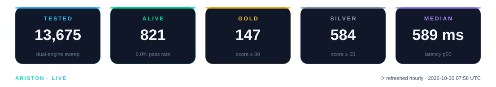
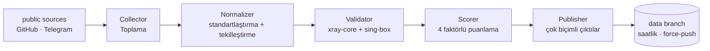

<p align="center">
  
</p>

<p align="center">
  <a href="https://github.com/Edsel-Rahimi/Ariston/stargazers"></a>
  <a href="https://github.com/Edsel-Rahimi/Ariston/actions/workflows/pipeline.yml"></a>
  
  <a href="LICENSE"></a>
</p>

<p align="center">
  <a href="README.md">🇮🇷 فارسی</a> · <a href="README.en.md">🇬🇧 English</a> · <b>🇹🇷 Türkçe</b> · <a href="README.zh.md">🇨🇳 中文</a> · <a href="README.ru.md">🇷🇺 Русский</a>
</p>

---

# 🏛️ Ariston

> **Sağlıklı ağ düğümlerinin sürekli doğrulanan havuzu — her saat rafine edilir.**
> *Antik Yunanca'da **Ariston** "en iyisi" demektir. Misyonumuz tek kelime: en iyisi.*

<p align="center">
  
</p>

<!-- stats:start -->
| | |
|---|---|
| 🕒 Son çalıştırma | **2026-10-29 22:39 UTC** |
| 🧹 Temizlik | **58,693 ham → 14,308 tekil** |
| 🧪 Canlı test | **5,379 düğüm (çift motor)** |
| ✅ Sağlıklı | **824 (15.3%)** |
| 🏅 Altın / Gümüş / Bronz | **84 / 657 / 83** |
| ⚡ Medyan gecikme | **574.9 ms** |
<!-- stats:end -->

## ⚡ Hemen başla — bir satırı kopyala

Yalnızca bir satırlık yeriniz varsa bunu içe aktarın — **son canlı taramada sağlam olduğu kanıtlanan** düğümler:

```text
# 🥇 en iyi kalite — altın seviye
https://raw.githubusercontent.com/Edsel-Rahimi/Ariston/data/gold.txt
# ✅ dengeli (önerilen) — bu turda sağlıklı olanların tamamı
https://raw.githubusercontent.com/Edsel-Rahimi/Ariston/data/validated.txt
# 🗂 her şey — tüm tekil düğümler
https://raw.githubusercontent.com/Edsel-Rahimi/Ariston/data/nodes.txt
```

**📱 Telefonda mısınız?** Bunlardan birini taratın — QR'in kendisi abonelik URL'ini kodlar; istemciniz her seferinde güncel listeyi çeker:

<p align="center">
  &nbsp;&nbsp;&nbsp;
  &nbsp;&nbsp;&nbsp;
  
</p>

## 🎛️ Seviyeler — tek havuz, farklı kanıt miktarı

Bu dosyalar farklı kaynaklar değildir; **aynı tekil havuzun**, her düğümün taşıdığı sağlık kanıtı miktarına göre filtrelenmiş halidir:

| Seviye | Kimler girer | Metin | Base64 |
|---|---|:---:|:---:|
| 🥇 **gold** | puan ≥ 80 — en hızlı ve en kararlılar | [txt](https://raw.githubusercontent.com/Edsel-Rahimi/Ariston/data/gold.txt) | [b64](https://raw.githubusercontent.com/Edsel-Rahimi/Ariston/data/gold.b64) |
| 🥈 **silver** | puan ≥ 55 — iyi kalite, daha fazla çeşit | [txt](https://raw.githubusercontent.com/Edsel-Rahimi/Ariston/data/silver.txt) | [b64](https://raw.githubusercontent.com/Edsel-Rahimi/Ariston/data/silver.b64) |
| ✅ **validated** | bu turda canlı testi geçenler | [txt](https://raw.githubusercontent.com/Edsel-Rahimi/Ariston/data/validated.txt) | [b64](https://raw.githubusercontent.com/Edsel-Rahimi/Ariston/data/validated.b64) |
| 🗂 **all** | tüm tekil düğümler — test edilmemiş | [txt](https://raw.githubusercontent.com/Edsel-Rahimi/Ariston/data/nodes.txt) | [b64](https://raw.githubusercontent.com/Edsel-Rahimi/Ariston/data/nodes.b64) |

**Hazır istemci yapılandırmaları** (canlı test edilmiş düğümlerden, en iyisi başta):

| Dosya | Kimin için |
|---|---|
| [`mihomo.yaml`](https://raw.githubusercontent.com/Edsel-Rahimi/Ariston/data/mihomo.yaml) | Mihomo · Clash.Meta · Clash Verge — en iyilerin otomatik seçim grubu |
| [`singbox.json`](https://raw.githubusercontent.com/Edsel-Rahimi/Ariston/data/singbox.json) | sing-box · SFA · SFI — seçici + otomatik urltest |

<details>
<summary>📎 Uygulamalara hızlı içe aktarma kılavuzu</summary>

- **v2rayNG** → Subscriptions → bir `.b64` dosyasının URL'sini ekleyin
- **Hiddify** → New Profile → `validated.txt` URL'si
- **NekoBox** → Groups → Add group → `validated.txt` URL'si
- **Streisand** → Configs → `+` → `validated.txt` URL'si
- **Clash Verge / Mihomo** → Import → `mihomo.yaml` URL'si
- **sing-box / SFI / SFA** → Profiles → New → `singbox.json` URL'si

</details>

## 🧪 "Gerçekten çalışıyor mu?" — tahmin değil, ölçüm

Çoğu depo size büyük bir sayı gösterir ve gerisini tahmininize bırakır. Ariston tersini yapar: **gerçek sayıyı ölçer ve gösterir.** Ücretsiz düğümlerin acı gerçeği şudur: herhangi bir anda havuzun çoğu ölüdür — bunu gizlemeyiz; her saat ölçer ve buna göre sıralarız.

| Aşama | Sorduğu soru | Maliyet |
|---|---|---|
| **L1 normalleştirme** | Ayrıştırılabilir mi? Tekil mi? Yönlendirilebilir mi? | ağ yok |
| **L2 başlatma** | Protokol el sıkışması gerçekten yanıt veriyor mu? | xray-core + sing-box çekirdekleri |
| **L3 gerçek sondaj** | Düğümün **içinden** geçen HTTP isteği `204` döndürüyor mu? | SOCKS5 + `/generate_204` |

> 🧭 **Neden iki motor?** Çünkü hiçbiri haritanın tamamını göremez: xray-core QUIC protokollerine (Hysteria2 / TUIC) kördür; sing-box ise bazı xray varyantlarını kaçırır. Her motor diğerinin kör noktasını kapatır — benzer projelerin çoğunun görmezden geldiği bir detay.

Bu anın canlı sayıları yukarıdaki istatistik tablosunda; tüm geçmiş [`results.json`](https://raw.githubusercontent.com/Edsel-Rahimi/Ariston/data/results.json) dosyasındadır.

## 🇮🇷 İran operatör ayrımı

İran şebekeleri üzerindeki düğümler ayrı yayınlanır — çoğunlukla ücretsiz ve daha hızlı olan yerel trafik için kullanışlıdır. Ayrım, coğrafi tahminle değil ASN sahiplik tablolarıyla yapılır:

| Operatör | Dosya | | Operatör | Dosya |
|---|---|---|---|---|
| 📡 MCI (Hamrah-e Aval) | [mci](https://raw.githubusercontent.com/Edsel-Rahimi/Ariston/data/by-operator/mci.txt) | | 🌐 Shatel | [shatel](https://raw.githubusercontent.com/Edsel-Rahimi/Ariston/data/by-operator/shatel.txt) |
| 📡 Irancell | [irancell](https://raw.githubusercontent.com/Edsel-Rahimi/Ariston/data/by-operator/irancell.txt) | | 🌐 MobinNet | [mobinnet](https://raw.githubusercontent.com/Edsel-Rahimi/Ariston/data/by-operator/mobinnet.txt) |
| 📡 TCI (Mokhaberat) | [tci](https://raw.githubusercontent.com/Edsel-Rahimi/Ariston/data/by-operator/tci.txt) | | 🌐 Asiatech | [asiatech](https://raw.githubusercontent.com/Edsel-Rahimi/Ariston/data/by-operator/asiatech.txt) |
| 📡 Rightel | [rightel](https://raw.githubusercontent.com/Edsel-Rahimi/Ariston/data/by-operator/rightel.txt) | | 🌐 ParsOnline | [parsonline](https://raw.githubusercontent.com/Edsel-Rahimi/Ariston/data/by-operator/parsonline.txt) |
| 📡 Pishgaman | [pishgaman](https://raw.githubusercontent.com/Edsel-Rahimi/Ariston/data/by-operator/pishgaman.txt) | | 🌐 Respina | [respina](https://raw.githubusercontent.com/Edsel-Rahimi/Ariston/data/by-operator/respina.txt) |
| | | | 🌍 diğer İR şebekeleri | [ir-other](https://raw.githubusercontent.com/Edsel-Rahimi/Ariston/data/by-operator/ir-other.txt) |

> Boş bir dosya, son turda o şebekede düğüm bulunamadığı anlamına gelir — dosyanın bozuk olduğu anlamına gelmez.

## ⚙️ Desteklenen protokoller

| Protokol | Toplama | Test |
|---|:---:|:---:|
| VLESS (Reality / Vision / XHTTP dahil) | ✅ | ✅ |
| VMess | ✅ | ✅ |
| Trojan | ✅ | ✅ |
| Shadowsocks / SS2022 | ✅ | ✅ |
| Hysteria2 | ✅ | ✅ |
| TUIC v5 | ✅ | ✅ |
| SSR | ✅ | — |

## 🏗 Mimari



Tam ayrıntılar: [`docs/architecture.md`](docs/architecture.md)

## ➕ Kaynak ekleme

Yeni bir kaynak biliyor musunuz (Telegram kanalı veya herkese açık dosya)? [`CONTRIBUTING.md`](CONTRIBUTING.md) dosyasına bakın — `pipeline/sources.json` dosyasını düzenleyen tek bir PR yeterlidir.

> ⚠️ **Adlandırma politikası:** Bu proje dosya adlarında, metinlerinde ve kodunda bilinçli olarak nötr ifadeler ("düğüm", "ağ uç noktası") kullanır; doğrudan marka adlarıyla yayına giren depoların ömrünün daha kısa olduğu görülmüştür. Lütfen PR'larda da aynı üslubu izleyin.

## 🗺 Yol haritası

- [x] **Aşama 1 — MVP:** toplama + standartlaştırma + tekilleştirme
- [x] **Aşama 1b — çift motor testi:** GitHub Actions üzerinde xray-core + sing-box
- [x] **Aşama 2 — puanlama ve istemciler:** altın/gümüş/bronz seviyeleri, mihomo.yaml + singbox.json, canlı istatistik
- [x] **Aşama 3 — operatörler ve bildirim:** İran ASN ayrımı, Telegram bildirimi, yansıtma
- [ ] **Aşama 4 — web panosu:** GitHub Pages üzerinde canlı sayfa
- [ ] **Aşama 5 — Telegram botu:** dosyaları Telegram içinde almak
- [ ] **Aşama 6 — ölçek:** daha fazla kaynak, çok bölgeli test

## ❓ SSS

<details>
<summary><b>Havuzun yalnızca bir bölümü neden canlı?</b></summary>

Bu, ücretsiz düğümlerin doğasıdır — hızla ölürler veya kalabalışırlar. Fark şu: bu gerçeği ham "on binlerce config" sayısıyla sizi ayartmak yerine **ölçüp gösteriyoruz.** Gerçek sayı, yukarıdaki istatistik tablosunda her saat yenilenir.

</details>

<details>
<summary><b>Hangi dosyayı kullanmalıyım?</b></summary>

- Yeni başlayan veya acelesi olan → `validated.txt` (dengeli, daha küçük)
- Yalnızca en iyisi → `gold.txt`
- Belirli bir istemci kullanıyorsanız → `mihomo.yaml` veya `singbox.json`
- Her şeyi keşfetmek isteyen → `nodes.txt`

</details>

<details>
<summary><b>Ne sıklıkla güncelleniyor?</b></summary>

Her saat :07'de (UTC) otomatik olarak. `data` dalı her zaman tam olarak tek bir anlık görüntü tutar (force-push); depo geçmişi hiçbir zaman şişmez ve bugün kopyaladığınız bağlantılar sonsuza kadar çalışmaya devam eder.

</details>

<details>
<summary><b>İfadeler neden bu kadar nötr?</b></summary>

Deneyim, başlıklarda ve metinlerde doğrudan marka kullanımının deponun kaldırılma riskini yükselttiğini gösteriyor. Ariston yalnızca herkese açık verileri indeksler ve rafine eder; kendini de bilinçli olarak böyle tanımlar — projenin uzun vadeli sürekliliği için.

</details>

## ⚖️ Yasal uyarı

Bu proje yalnızca herkese açık verileri **indeksler ve rafine eder**; hizmet sunmaz ve hiçbir sunucuya sahip değildir. Tüm veriler internetteki herkese açık kaynaklardan derlenmiştir ve kullanım sorumluluğu kullanıcıya aittir. Proje hiçbir araca veya satıcıya bağlı değildir ve araştırma ile eğitim amaçlı sunulmaktadır. İçeriğin sahibiyseniz ve indekslenmesine itiraz ediyorsanız bir Issue açın; derhal kaldırılır.

## 📄 Lisans

MIT — ayrıntılar için [`LICENSE`](LICENSE)

---

<p align="center">
  İşinize yaradıysa, deponun ayakta kalması için bir ⭐ bırakın.
</p>
