<p align="center">
  
</p>

<p align="center">
  <a href="https://github.com/Edsel-Rahimi/Ariston/stargazers"></a>
  <a href="https://github.com/Edsel-Rahimi/Ariston/actions/workflows/pipeline.yml"></a>
  
  <a href="LICENSE"></a>
</p>

<p align="center">
  <a href="README.fa.md"></a>&nbsp;
  <a href="README.md"></a>&nbsp;
  <a href="README.tr.md"></a>&nbsp;
  <a href="README.ru.md"></a>&nbsp;
  <a href="README.zh.md"></a>
</p>

> **Sağlam düğüm deposu — her saat filtrelenir.** Eski Yunanca'da **Ariston** “en iyi” demektir; amaç da tam olarak bu. Aşağıdaki karttaki sayılar son gerçek hattın çıktısından üretilir — pazarlama matematiği yok.

<p align="center">
  
</p>

## ⚡ Quick start

<p align="center">
  
</p>

Tek bir satırlık yeriniz varsa bunu içe aktarın:

```text
# best quality — gold tier
https://raw.githubusercontent.com/Edsel-Rahimi/Ariston/data/gold.txt
# balanced (recommended) — everything healthy this run
https://raw.githubusercontent.com/Edsel-Rahimi/Ariston/data/validated.txt
# everything — the full unique pool
https://raw.githubusercontent.com/Edsel-Rahimi/Ariston/data/nodes.txt
```

**Telefonda mısınız?** Bu kodlardan birini tarayın:

<p align="center">
  &nbsp;&nbsp;&nbsp;
  &nbsp;&nbsp;&nbsp;
  
</p>

## 🎛️ Tiers — text & Base64, one click

Bu dosyalar farklı kaynaklar değil; **tek bir tekrarsız havuzun**, her düğümün sağlık kanıtına göre filtrelenmiş hâlleridir. Karta veya düğmeye tıklayın:

<p align="center">
  <a href="https://raw.githubusercontent.com/Edsel-Rahimi/Ariston/data/gold.txt"></a>
  <a href="https://raw.githubusercontent.com/Edsel-Rahimi/Ariston/data/gold.txt"></a>
  <a href="https://raw.githubusercontent.com/Edsel-Rahimi/Ariston/data/gold.b64"></a>
</p>

<p align="center">
  <a href="https://raw.githubusercontent.com/Edsel-Rahimi/Ariston/data/silver.txt"></a>
  <a href="https://raw.githubusercontent.com/Edsel-Rahimi/Ariston/data/silver.txt"></a>
  <a href="https://raw.githubusercontent.com/Edsel-Rahimi/Ariston/data/silver.b64"></a>
</p>

<p align="center">
  <a href="https://raw.githubusercontent.com/Edsel-Rahimi/Ariston/data/validated.txt"></a>
  <a href="https://raw.githubusercontent.com/Edsel-Rahimi/Ariston/data/validated.txt"></a>
  <a href="https://raw.githubusercontent.com/Edsel-Rahimi/Ariston/data/validated.b64"></a>
</p>

<p align="center">
  <a href="https://raw.githubusercontent.com/Edsel-Rahimi/Ariston/data/all.txt"></a>
  <a href="https://raw.githubusercontent.com/Edsel-Rahimi/Ariston/data/all.txt"></a>
  <a href="https://raw.githubusercontent.com/Edsel-Rahimi/Ariston/data/all.b64"></a>
</p>

## 🖥️ Ready-made client configs

Son çalıştırmanın canlı düğümlerinden, en iyisi başta — dosyayı açmak için karta tıklayın:

<p align="center">
  <a href="https://raw.githubusercontent.com/Edsel-Rahimi/Ariston/data/mihomo.yaml"></a>&nbsp;
  <a href="https://raw.githubusercontent.com/Edsel-Rahimi/Ariston/data/singbox.json"></a>
</p>

<details>
<summary>📎 Import guide</summary>

- **v2rayNG** → Subscriptions → add the `.b64` URL
- **Hiddify** → New Profile → `validated.txt` URL
- **NekoBox** → Groups → Add group → `validated.txt` URL
- **Streisand** → Configs → `+` → `validated.txt` URL
- **Clash Verge / Mihomo** → Import → `mihomo.yaml` URL
- **sing-box / SFA / SFI** → Profiles → New → `singbox.json` URL

</details>

## 🧪 "Does it actually work?" — measured, not estimated

<p align="center">
  
</p>

Çoğu depo büyük bir sayı gösterir ve sizi tahminle baş başa bırakır. Ariston tersini yapar: **gerçek sayıyı ölçer ve gösterir.** Düğüm bazlı geçmiş [`results.json`](https://raw.githubusercontent.com/Edsel-Rahimi/Ariston/data/results.json) içinde; yukarıdaki kart her saat yenilenir.

## 🇮🇷 Iranian operator split

IP'si İran ağlarına ait düğümler ayrı yayımlanır — çoğu zaman ücretsiz ve hızlı olan yerel trafik için. Ayrım ASN tablosuna (ağın sahibine) dayanır, coğrafi tahmine değil. **Dosyayı açmak için karta tıklayın:**

<p align="center">
  <a href="https://raw.githubusercontent.com/Edsel-Rahimi/Ariston/data/by-operator/irancell.txt"></a>
  <a href="https://raw.githubusercontent.com/Edsel-Rahimi/Ariston/data/by-operator/mci.txt"></a>
  <a href="https://raw.githubusercontent.com/Edsel-Rahimi/Ariston/data/by-operator/tci.txt"></a>
  <a href="https://raw.githubusercontent.com/Edsel-Rahimi/Ariston/data/by-operator/rightel.txt"></a>
  <a href="https://raw.githubusercontent.com/Edsel-Rahimi/Ariston/data/by-operator/pishgaman.txt"></a>
  <a href="https://raw.githubusercontent.com/Edsel-Rahimi/Ariston/data/by-operator/shatel.txt"></a>
  <a href="https://raw.githubusercontent.com/Edsel-Rahimi/Ariston/data/by-operator/mobinnet.txt"></a>
  <a href="https://raw.githubusercontent.com/Edsel-Rahimi/Ariston/data/by-operator/asiatech.txt"></a>
  <a href="https://raw.githubusercontent.com/Edsel-Rahimi/Ariston/data/by-operator/parsonline.txt"></a>
  <a href="https://raw.githubusercontent.com/Edsel-Rahimi/Ariston/data/by-operator/respina.txt"></a>
  <a href="https://raw.githubusercontent.com/Edsel-Rahimi/Ariston/data/by-operator/ir-other.txt"></a>
</p>

> Boş dosya, son çalıştırmada o ağda düğüm bulunmadığı anlamına gelir — dosya bozuk değil.

## ⚙️ Supported protocols

<p align="center">
  
</p>

## 🏗 Architecture

<p align="center">
  
</p>

Every station in detail: [`docs/architecture.md`](docs/architecture.md)

## ➕ Adding a source

Yeni bir kaynağınız mı var (Telegram kanalı veya herkese açık dosya)? [`CONTRIBUTING.md`](CONTRIBUTING.md) — `pipeline/sources.json` düzenleyen tek bir PR yeter.

> ⚠️ **Adlandırma politikası:** bu proje dosya adlarında, metinlerde ve kodda bilinçli olarak nötr kelimeler (“düğüm”, “ağ ucu”) kullanır; açık adlandırma kullanan depoların öne çıktı bilinir. Lütfen PR'lerde de aynı dili koruyun.

## 🗺 Roadmap

- [x] **Faz 1 — MVP: toplama + normalleştirme + tekrarsızlaştırma**
- [x] **Faz 1b — çift motor testi: GitHub Actions'ta xray-core + sing-box**
- [x] **Faz 2 — puanlama ve istemciler: altın/gümüş/bronz, mihomo.yaml, singbox.json**
- [x] **Faz 3 — operatörler ve bildirim: İran ASN ayrımı, Telegram bildirimi, aynalar**
- [ ] **Faz 4 — web panosu: GitHub Pages'te canlı sayfa**
- [ ] **Faz 5 — Telegram botu: dosyaları Telegram içinde almak**

## ❓ FAQ

<details>
<summary><b>Bu kadar düğümden neden yalnızca bu kadarı canlı?</b></summary>

Ücretsiz konfigürasyonların doğası bu — düğümler hızla ölür veya kalabalıklaşır. Fark şu: gerçeği uydurmak yerine **ölçüp gösteriyoruz.** Gerçek sayı her saat kartta yenilenir.

</details>

<details>
<summary><b>Hangi dosya bana uygun?</b></summary>

Yeni başlayan veya acelesi olan → `validated.txt` · sadece en iyiler → `gold.txt` · belirli uygulama → `mihomo.yaml` / `singbox.json` · kendim karışmak isterim → `nodes.txt`

</details>

<details>
<summary><b>Ne sıklıkta güncellenir?</b></summary>

Her saat :07 UTC'de otomatik. `data` dalı her zaman tek bir anlık görüntü tutar; bugün kopyaladığınız bağlantılar geçerli kalır.

</details>

<details>
<summary><b>Dil neden bu kadar nötr?</b></summary>

Açık adlandırmanın kaldırılma riskini artırdığı biliniyor. Ariston yalnızca herkese açık veriyi indeksler ve filtreler — uzun ömür için.

</details>

## ⚖️ Disclaimer

Bu proje yalnızca herkese açık veriyi **indeksler ve filtreler**; hizmet sunmaz, sunucu işletmez. Sorumluluk kullanıcıya aittir. İçerik sahibiyseniz bir issue açın, anında kaldırılır.

## 📄 License

MIT — see [`LICENSE`](LICENSE)

---

<p align="center">
  İşinize yaradıysa, depoyu ayakta tutmak için bir ⭐ bırakın.
</p>
