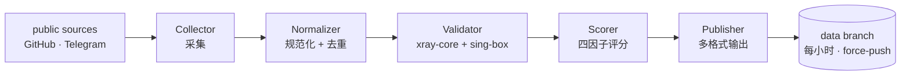

<p align="center">
  
</p>

<p align="center">
  <a href="https://github.com/Edsel-Rahimi/Ariston/stargazers"></a>
  <a href="https://github.com/Edsel-Rahimi/Ariston/actions/workflows/pipeline.yml"></a>
  
  <a href="LICENSE"></a>
</p>

<p align="center">
  <a href="README.md">🇮🇷 فارسی</a> · <a href="README.en.md">🇬🇧 English</a> · <a href="README.tr.md">🇹🇷 Türkçe</a> · <b>🇨🇳 中文</b> · <a href="README.ru.md">🇷🇺 Русский</a>
</p>

---

# 🏛️ Ariston

> **持续净化的健康网络节点资源池 — 每小时刷新。**
> *在古希腊语中，**Ariston** 意为「最优」。这正是本项目的全部使命。*

<p align="center">
  
</p>

<!-- stats:start -->
| | |
|---|---|
| 🕒 最近运行 | **2026-10-29 20:50 UTC** |
| 🧹 清洗 | **17,219 原始 → 8,771 唯一** |
| 🧪 实测 | **8,713 个节点（双引擎）** |
| ✅ 可用 | **345 (4.0%)** |
| 🇮🇷 位于伊朗网络 | **52** |
| 🏅 金 / 银 / 铜 | **70 / 226 / 49** |
| ⚡ 中位延迟 | **556.1 ms** |
<!-- stats:end -->

## ⚡ 快速开始 — 复制一行

如果只容得下一行，就导入这一行 — **最近一次实测中确认可用的**节点：

```text
# 🥇 最高质量 — 金级
https://raw.githubusercontent.com/Edsel-Rahimi/Ariston/data/gold.txt
# ✅ 均衡（推荐）— 本次实测的全部可用节点
https://raw.githubusercontent.com/Edsel-Rahimi/Ariston/data/validated.txt
# 🗂 全部 — 所有唯一节点
https://raw.githubusercontent.com/Edsel-Rahimi/Ariston/data/nodes.txt
```

**📱 在手机上？** 扫描其中一个二维码 — 二维码编码的是订阅链接本身，客户端每次都会拉取最新列表：

<p align="center">
  &nbsp;&nbsp;&nbsp;
  &nbsp;&nbsp;&nbsp;
  
</p>

## 🎛️ 等级 — 同一资源池，不同的证据强度

这些文件并非不同来源，而是**同一个去重后的资源池**，按每个节点所携带的健康证据强度过滤：

| 等级 | 包含内容 | 文本 | Base64 |
|---|---|:---:|:---:|
| 🥇 **gold** | 评分 ≥ 80 — 最快、最稳定 | [txt](https://raw.githubusercontent.com/Edsel-Rahimi/Ariston/data/gold.txt) | [b64](https://raw.githubusercontent.com/Edsel-Rahimi/Ariston/data/gold.b64) |
| 🥈 **silver** | 评分 ≥ 55 — 质量良好，种类更多 | [txt](https://raw.githubusercontent.com/Edsel-Rahimi/Ariston/data/silver.txt) | [b64](https://raw.githubusercontent.com/Edsel-Rahimi/Ariston/data/silver.b64) |
| ✅ **validated** | 本次实测通过 | [txt](https://raw.githubusercontent.com/Edsel-Rahimi/Ariston/data/validated.txt) | [b64](https://raw.githubusercontent.com/Edsel-Rahimi/Ariston/data/validated.b64) |
| 🗂 **all** | 所有唯一节点 — 未测试 | [txt](https://raw.githubusercontent.com/Edsel-Rahimi/Ariston/data/nodes.txt) | [b64](https://raw.githubusercontent.com/Edsel-Rahimi/Ariston/data/nodes.b64) |

**开箱即用的客户端配置**（由实测节点生成，最优在前）：

| 文件 | 适用 |
|---|---|
| [`mihomo.yaml`](https://raw.githubusercontent.com/Edsel-Rahimi/Ariston/data/mihomo.yaml) | Mihomo · Clash.Meta · Clash Verge — 自动优选组 |
| [`singbox.json`](https://raw.githubusercontent.com/Edsel-Rahimi/Ariston/data/singbox.json) | sing-box · SFA · SFI — 选择器 + 自动 urltest |

<details>
<summary>📎 各客户端快速导入指南</summary>

- **v2rayNG** → Subscriptions → 添加 `.b64` 文件的 URL
- **Hiddify** → New Profile → `validated.txt` 的 URL
- **NekoBox** → Groups → Add group → `validated.txt` 的 URL
- **Streisand** → Configs → `+` → `validated.txt` 的 URL
- **Clash Verge / Mihomo** → Import → `mihomo.yaml` 的 URL
- **sing-box / SFI / SFA** → Profiles → New → `singbox.json` 的 URL

</details>

## 🧪 「真的能用吗？」— 实测数据，不是估算

大多数仓库给你一个大数字，然后让你自己猜。Ariston 恰恰相反：**测量真实数字并公开展示。** 免费节点的残酷现实是：任何时刻，资源池的大多数节点已经死亡 — 我们不掩盖这一点，而是每小时测量并据此排名。

| 阶段 | 验证的问题 | 成本 |
|---|---|---|
| **L1 规范化** | 可解析？唯一？可路由？ | 无网络 |
| **L2 启动** | 协议握手是否真的有响应？ | xray-core + sing-box 内核 |
| **L3 真实探测** | **经由**节点的 HTTP 请求是否返回 `204`？ | SOCKS5 + `/generate_204` |

> 🧭 **为什么用双引擎？** 因为没有任何一个引擎能看到全图：xray-core 看不见 QUIC 协议（Hysteria2 / TUIC），而 sing-box 会漏掉部分 xray 变体。两个引擎互为盲区补充 — 这是多数同类项目忽略的细节。

此刻的实时数字见上方统计表；完整历史见 [`results.json`](https://raw.githubusercontent.com/Edsel-Rahimi/Ariston/data/results.json)。

## 🇮🇷 伊朗运营商分列

位于伊朗网络上的节点单独发布 — 对国内流量很有用，通常免费且更快。分列基于 ASN 归属表，而非地理位置猜测：

| 运营商 | 文件 | | 运营商 | 文件 |
|---|---|---|---|---|
| 📡 MCI（Hamrah-e Aval） | [mci](https://raw.githubusercontent.com/Edsel-Rahimi/Ariston/data/by-operator/mci.txt) | | 🌐 Shatel | [shatel](https://raw.githubusercontent.com/Edsel-Rahimi/Ariston/data/by-operator/shatel.txt) |
| 📡 Irancell | [irancell](https://raw.githubusercontent.com/Edsel-Rahimi/Ariston/data/by-operator/irancell.txt) | | 🌐 MobinNet | [mobinnet](https://raw.githubusercontent.com/Edsel-Rahimi/Ariston/data/by-operator/mobinnet.txt) |
| 📡 TCI（Mokhaberat） | [tci](https://raw.githubusercontent.com/Edsel-Rahimi/Ariston/data/by-operator/tci.txt) | | 🌐 Asiatech | [asiatech](https://raw.githubusercontent.com/Edsel-Rahimi/Ariston/data/by-operator/asiatech.txt) |
| 📡 Rightel | [rightel](https://raw.githubusercontent.com/Edsel-Rahimi/Ariston/data/by-operator/rightel.txt) | | 🌐 ParsOnline | [parsonline](https://raw.githubusercontent.com/Edsel-Rahimi/Ariston/data/by-operator/parsonline.txt) |
| 📡 Pishgaman | [pishgaman](https://raw.githubusercontent.com/Edsel-Rahimi/Ariston/data/by-operator/pishgaman.txt) | | 🌐 Respina | [respina](https://raw.githubusercontent.com/Edsel-Rahimi/Ariston/data/by-operator/respina.txt) |
| | | | 🌍 其他伊朗网络 | [ir-other](https://raw.githubusercontent.com/Edsel-Rahimi/Ariston/data/by-operator/ir-other.txt) |

> 文件为空只表示最近一次运行没有发现该网络上的节点，并不代表文件损坏。

## ⚙️ 支持的协议

| 协议 | 采集 | 测试 |
|---|:---:|:---:|
| VLESS（含 Reality / Vision / XHTTP） | ✅ | ✅ |
| VMess | ✅ | ✅ |
| Trojan | ✅ | ✅ |
| Shadowsocks / SS2022 | ✅ | ✅ |
| Hysteria2 | ✅ | ✅ |
| TUIC v5 | ✅ | ✅ |
| SSR | ✅ | — |

## 🏗 架构



完整细节：[`docs/architecture.md`](docs/architecture.md)

## ➕ 添加来源

知道新的来源（Telegram 频道或公开文件）？参见 [`CONTRIBUTING.md`](CONTRIBUTING.md) — 只需一个编辑 `pipeline/sources.json` 的 PR。

> ⚠️ **命名策略：** 本项目在文件名、文本和代码中刻意使用中性措辞（「节点」「网络端点」）；经验表明，以直白名称自我标榜的仓库存活期往往更短。请在 PR 中保持同样风格。

## 🗺 路线图

- [x] **阶段 1 — MVP：** 采集 + 规范化 + 去重
- [x] **阶段 1b — 双引擎测试：** 在 GitHub Actions 上运行 xray-core + sing-box
- [x] **阶段 2 — 评分与客户端：** 金/银/铜分级，mihomo.yaml + singbox.json，实时统计
- [x] **阶段 3 — 运营商与通知：** 伊朗 ASN 分列，Telegram 通知，镜像
- [ ] **阶段 4 — 网页面板：** GitHub Pages 上的实时页面
- [ ] **阶段 5 — Telegram 机器人：** 在 Telegram 内直接获取文件
- [ ] **阶段 6 — 规模化：** 更多来源，多区域测试

## ❓ 常见问题

<details>
<summary><b>为什么资源池中只有一小部分可用？</b></summary>

这就是免费节点的本性 — 它们很快死亡或变得拥挤。区别在于：我们**测量并展示**这一现实，而不是用「数万条配置」的原始数字诱惑你。真实数字每小时在上方统计表中刷新。

</details>

<details>
<summary><b>我应该用哪个文件？</b></summary>

- 新手或赶时间 → `validated.txt`（均衡、更小）
- 只用最好的 → `gold.txt`
- 使用特定客户端 → `mihomo.yaml` 或 `singbox.json`
- 想全部探索 → `nodes.txt`

</details>

<details>
<summary><b>多久更新一次？</b></summary>

每小时 ：07（UTC）自动运行。`data` 分支始终只保存一个快照（force-push）；仓库历史永不膨胀，今天复制的链接永远有效。

</details>

<details>
<summary><b>为什么措辞如此中性？</b></summary>

经验表明，在标题和文本中使用直白名称会增加仓库被移除的风险。Ariston 仅对公开数据进行索引与净化，并刻意如此自我描述 — 为了项目的长期存续。

</details>

## ⚖️ 免责声明

本项目仅对公开数据进行**索引与净化**；不提供服务，也不拥有任何服务器。所有数据均收集自互联网上的公开来源，任何使用的责任由用户自行承担。本项目不隶属于任何工具或厂商，仅供研究与教育目的。如果您是内容所有者且反对被索引，请提交 Issue，我们会立即删除。

## 📄 许可证

MIT — 详见 [`LICENSE`](LICENSE)

---

<p align="center">
  如果对你有帮助，请点一个 ⭐ 让仓库持续存活。
</p>
