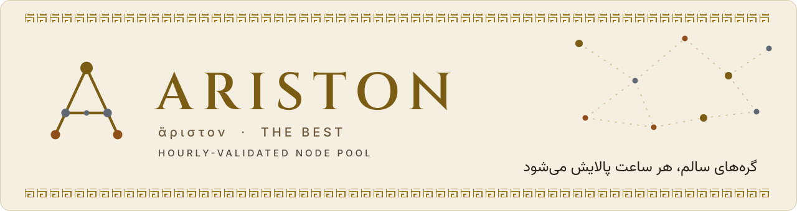

<p align="center">
  <picture><source media="(prefers-color-scheme: dark)" srcset="assets/dark/banner.svg"></picture>
</p>

<p align="center">
  <a href="https://github.com/Edsel-Rahimi/Ariston/stargazers"></a>
  <a href="https://github.com/Edsel-Rahimi/Ariston/actions/workflows/pipeline.yml"></a>
  
  <a href="LICENSE"></a>
</p>

<p align="center">
  <a href="README.md"><picture><source media="(prefers-color-scheme: dark)" srcset="assets/dark/lang-fa.svg"></picture></a>&nbsp;
  <a href="README.md"><picture><source media="(prefers-color-scheme: dark)" srcset="assets/dark/lang-en.svg"></picture></a>&nbsp;
  <a href="README.tr.md"><picture><source media="(prefers-color-scheme: dark)" srcset="assets/dark/lang-tr.svg"></picture></a>&nbsp;
  <a href="README.ru.md"><picture><source media="(prefers-color-scheme: dark)" srcset="assets/dark/lang-ru.svg"></picture></a>&nbsp;
  <a href="README.zh.md"><picture><source media="(prefers-color-scheme: dark)" srcset="assets/dark/lang-zh-on.svg"></picture></a>
</p>

> **健康节点仓库 — 每小时过滤一次。** 在古希腊语中，**Ariston** 意为“最好”，这正是我们的目标。下方卡片中的数字来自上一次真实流水线运行——不是营销数字。

<p align="center">
  <picture><source media="(prefers-color-scheme: dark)" srcset="assets/dark/run-card.svg"></picture>
</p>

## Quick start

<p align="center">
  <picture><source media="(prefers-color-scheme: dark)" srcset="assets/dark/quickstart.svg"></picture>
</p>

只放得下一行？导入这个：

```text
# best quality — gold tier
https://raw.githubusercontent.com/Edsel-Rahimi/Ariston/data/gold.txt
# balanced (recommended) — everything healthy this run
https://raw.githubusercontent.com/Edsel-Rahimi/Ariston/data/validated.txt
# everything — the full unique pool
https://raw.githubusercontent.com/Edsel-Rahimi/Ariston/data/nodes.txt
```

**在手机上？** 扫描其中一个二维码：

<p align="center">
  &nbsp;&nbsp;&nbsp;
  &nbsp;&nbsp;&nbsp;
  
</p>

## Tiers — text & Base64, one click

这些文件不是不同来源；它们是**同一个去重后的节点池**，按“健康证据多少”过滤而成。点击卡片或按钮：

<p align="center">
  <a href="https://raw.githubusercontent.com/Edsel-Rahimi/Ariston/data/gold.txt"><picture><source media="(prefers-color-scheme: dark)" srcset="assets/dark/tier-gold.svg"></picture></a>
  <a href="https://raw.githubusercontent.com/Edsel-Rahimi/Ariston/data/gold.txt"><picture><source media="(prefers-color-scheme: dark)" srcset="assets/dark/btn-text.svg"></picture></a>
  <a href="https://raw.githubusercontent.com/Edsel-Rahimi/Ariston/data/gold.b64"><picture><source media="(prefers-color-scheme: dark)" srcset="assets/dark/btn-b64.svg"></picture></a>
</p>

<p align="center">
  <a href="https://raw.githubusercontent.com/Edsel-Rahimi/Ariston/data/silver.txt"><picture><source media="(prefers-color-scheme: dark)" srcset="assets/dark/tier-silver.svg"></picture></a>
  <a href="https://raw.githubusercontent.com/Edsel-Rahimi/Ariston/data/silver.txt"><picture><source media="(prefers-color-scheme: dark)" srcset="assets/dark/btn-text.svg"></picture></a>
  <a href="https://raw.githubusercontent.com/Edsel-Rahimi/Ariston/data/silver.b64"><picture><source media="(prefers-color-scheme: dark)" srcset="assets/dark/btn-b64.svg"></picture></a>
</p>

<p align="center">
  <a href="https://raw.githubusercontent.com/Edsel-Rahimi/Ariston/data/validated.txt"><picture><source media="(prefers-color-scheme: dark)" srcset="assets/dark/tier-validated.svg"></picture></a>
  <a href="https://raw.githubusercontent.com/Edsel-Rahimi/Ariston/data/validated.txt"><picture><source media="(prefers-color-scheme: dark)" srcset="assets/dark/btn-text.svg"></picture></a>
  <a href="https://raw.githubusercontent.com/Edsel-Rahimi/Ariston/data/validated.b64"><picture><source media="(prefers-color-scheme: dark)" srcset="assets/dark/btn-b64.svg"></picture></a>
</p>

<p align="center">
  <a href="https://raw.githubusercontent.com/Edsel-Rahimi/Ariston/data/all.txt"><picture><source media="(prefers-color-scheme: dark)" srcset="assets/dark/tier-all.svg"></picture></a>
  <a href="https://raw.githubusercontent.com/Edsel-Rahimi/Ariston/data/all.txt"><picture><source media="(prefers-color-scheme: dark)" srcset="assets/dark/btn-text.svg"></picture></a>
  <a href="https://raw.githubusercontent.com/Edsel-Rahimi/Ariston/data/all.b64"><picture><source media="(prefers-color-scheme: dark)" srcset="assets/dark/btn-b64.svg"></picture></a>
</p>

## Ready-made client configs

由最近一次运行的存活节点生成，优选在前——点击卡片即可打开文件：

<p align="center">
  <a href="https://raw.githubusercontent.com/Edsel-Rahimi/Ariston/data/mihomo.yaml"><picture><source media="(prefers-color-scheme: dark)" srcset="assets/dark/client-mihomo.svg"></picture></a>&nbsp;
  <a href="https://raw.githubusercontent.com/Edsel-Rahimi/Ariston/data/singbox.json"><picture><source media="(prefers-color-scheme: dark)" srcset="assets/dark/client-singbox.svg"></picture></a>
</p>

<details>
<summary>📎 Import guide</summary>

- **v2rayNG** → Subscriptions → add the `.b64` URL
- **Hiddify** → New Profile → `validated.txt` URL
- **NekoBox** → Groups → Add group → `validated.txt` URL
- **Streisand** → Configs → `+` → `validated.txt` URL
- **Clash Verge / Mihomo** → Import → `mihomo.yaml` URL
- **sing-box / SFA / SFI** → Profiles → New → `singbox.json` URL

</details>

## "Does it actually work?" — measured, not estimated

<p align="center">
  <picture><source media="(prefers-color-scheme: dark)" srcset="assets/dark/proof.svg"></picture>
</p>

大多数仓库只显示一个大数字，让你自己去猜。Ariston 反其道而行：**实测并展示真实数字。**每个节点的完整历史在 [`results.json`](https://raw.githubusercontent.com/Edsel-Rahimi/Ariston/data/results.json)；上方卡片每小时刷新。

## Iranian operator split

IP 属于伊朗网络的节点单独发布——国内流量通常更免费、更快速。分流依据 ASN 表（网络归属），而不是地理猜测。**点击卡片打开对应网络的文件：**

<p align="center">
  <a href="https://raw.githubusercontent.com/Edsel-Rahimi/Ariston/data/by-operator/irancell.txt"><picture><source media="(prefers-color-scheme: dark)" srcset="assets/dark/op-irancell.svg"></picture></a>
  <a href="https://raw.githubusercontent.com/Edsel-Rahimi/Ariston/data/by-operator/mci.txt"><picture><source media="(prefers-color-scheme: dark)" srcset="assets/dark/op-mci.svg"></picture></a>
  <a href="https://raw.githubusercontent.com/Edsel-Rahimi/Ariston/data/by-operator/tci.txt"><picture><source media="(prefers-color-scheme: dark)" srcset="assets/dark/op-tci.svg"></picture></a>
  <a href="https://raw.githubusercontent.com/Edsel-Rahimi/Ariston/data/by-operator/rightel.txt"><picture><source media="(prefers-color-scheme: dark)" srcset="assets/dark/op-rightel.svg"></picture></a>
  <a href="https://raw.githubusercontent.com/Edsel-Rahimi/Ariston/data/by-operator/pishgaman.txt"><picture><source media="(prefers-color-scheme: dark)" srcset="assets/dark/op-pishgaman.svg"></picture></a>
  <a href="https://raw.githubusercontent.com/Edsel-Rahimi/Ariston/data/by-operator/shatel.txt"><picture><source media="(prefers-color-scheme: dark)" srcset="assets/dark/op-shatel.svg"></picture></a>
  <a href="https://raw.githubusercontent.com/Edsel-Rahimi/Ariston/data/by-operator/mobinnet.txt"><picture><source media="(prefers-color-scheme: dark)" srcset="assets/dark/op-mobinnet.svg"></picture></a>
  <a href="https://raw.githubusercontent.com/Edsel-Rahimi/Ariston/data/by-operator/asiatech.txt"><picture><source media="(prefers-color-scheme: dark)" srcset="assets/dark/op-asiatech.svg"></picture></a>
  <a href="https://raw.githubusercontent.com/Edsel-Rahimi/Ariston/data/by-operator/parsonline.txt"><picture><source media="(prefers-color-scheme: dark)" srcset="assets/dark/op-parsonline.svg"></picture></a>
  <a href="https://raw.githubusercontent.com/Edsel-Rahimi/Ariston/data/by-operator/respina.txt"><picture><source media="(prefers-color-scheme: dark)" srcset="assets/dark/op-respina.svg"></picture></a>
  <a href="https://raw.githubusercontent.com/Edsel-Rahimi/Ariston/data/by-operator/ir-other.txt"><picture><source media="(prefers-color-scheme: dark)" srcset="assets/dark/op-ir-other.svg"></picture></a>
</p>

> 文件为空表示上一次运行在该网络上没有发现节点——不是文件损坏。

## Supported protocols

<p align="center">
  <picture><source media="(prefers-color-scheme: dark)" srcset="assets/dark/protocols.svg"></picture>
</p>

## Architecture

<p align="center">
  <picture><source media="(prefers-color-scheme: dark)" srcset="assets/dark/architecture.svg"></picture>
</p>

Every station in detail: [`docs/architecture.md`](docs/architecture.md)

## Adding a source

有新来源（Telegram 频道或公开文件）？参见 [`CONTRIBUTING.md`](CONTRIBUTING.md) —— 修改 `pipeline/sources.json` 的一个 PR 即可。

> ⚠️ **命名策略：**本项目在文件名、文本和代码中刻意使用中性词汇（“节点”“网络端点”）；经验表明，使用直白命名的仓库存续更短。请在 PR 中同样保持中性。

## Roadmap

- [x] **阶段 1 — MVP：采集 + 规范化 + 去重**
- [x] **阶段 1b — 双引擎测试：在 GitHub Actions 上运行 xray-core + sing-box**
- [x] **阶段 2 — 评分与客户端：金/银/铜分层，mihomo.yaml、singbox.json**
- [x] **阶段 3 — 运营商与通知：伊朗 ASN 分流、Telegram 通知、镜像**
- [ ] **阶段 4 — 网页面板：GitHub Pages 上的实时页面**
- [ ] **阶段 5 — Telegram 机器人：在 Telegram 内直接获取文件**

## FAQ

<details>
<summary><b>这么多节点，为什么存活的只有这些？</b></summary>

免费配置的本质如此——节点很快死亡或拥挤。区别在于我们**实测并展示**这一现实，而不是用“数万配置”的原始数字迷惑你。真实数字每小时在卡片上更新。

</details>

<details>
<summary><b>哪个文件适合我？</b></summary>

新手或赶时间 → `validated.txt` · 只要最好的 → `gold.txt` · 特定应用 → `mihomo.yaml` / `singbox.json` · 想自己翻 → `nodes.txt`

</details>

<details>
<summary><b>多久更新一次？</b></summary>

每小时 :07 UTC 自动运行。`data` 分支始终只保留一个快照；今天复制的链接始终有效。

</details>

<details>
<summary><b>为什么措辞如此中性？</b></summary>

经验表明直白命名会提高被删除的风险。Ariston 只对公开数据做索引与过滤——为了项目能长久运行。

</details>

## Disclaimer

本项目仅对公开数据做**索引与过滤**；不提供服务，也不持有任何服务器。使用责任由用户承担。如果您是内容所有者且反对被索引，请提交 issue，我们会立即删除。

## License

MIT — see [`LICENSE`](LICENSE)

---

<p align="center">
  如果对你有帮助，点一个 ⭐ 让仓库活下去。
</p>
