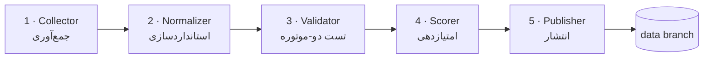

# معماری آریستون

> Five-stage pipeline · Architecture reference

## نمای کلی

آریستون یک خط‌لوله‌ی پنج‌مرحله‌ای است که تماماً داخل GitHub Actions اجرا می‌شود — بدون هیچ سرور، بدون هیچ هزینه‌ی ثابت:



## مراحل

| # | مرحله | ورودی | خروجی | وضعیت |
|---|---|---|---|---|
| 1 | **Collector** | `pipeline/sources.json` | متن خام منابع + URI ها | ✅ فعال |
| 2 | **Normalizer** | URI های خام | URI های کانونی + کلید هویت سرور | ✅ فعال |
| 3 | **Validator** | URI های یکتا | تأخیر + نرخ موفقیت + وضعیت | 🚧 فاز ۱ب |
| 4 | **Scorer** | نتایج تست | امتیاز ۰–۱۰۰ + رده‌بندی | 🚧 فاز ۲ |
| 5 | **Publisher** | امتیازها | فایل‌های چندفرمته + README زنده | 🚧 فاز ۲ |

## چرا دو موتور تست؟

| موتور | پوشش پروتکل | نکته |
|---|---|---|
| **xray-core** | VMess · VLESS · Trojan · Shadowsocks (شامل Reality، Vision، XHTTP) | استاندارد طلایی برای پروتکل‌های TCP/TLS |
| **sing-box** | Hysteria2 · TUIC · AnyTLS | خانواده‌ی QUIC/UDP — **xray اصلاً پشتیبانی نمی‌کند** |

اکثر مخازن مشابه فقط xray دارند و گره‌های QUIC را «کورکورانه» منتشر می‌کنند؛ آب‌انبار هر دو موتور را در هر اجرا دانلود و اجرا می‌کند (نسخه‌های ثابت‌شده = تکرارپذیری).

## استراتژی انتشار: شاخه‌ی `data`

- خروجی‌ها به شاخه‌ی `data` با **force-push** می‌روند → در هر لحظه فقط یک snapshot وجود دارد
- تاریخچه‌ی `main` هرگز رشد نمی‌کند (بعضی مخازن به ۲۳هزار کامیت رسیده‌اند!)
- `main` فقط کد + README است؛ `data` فقط داده — جدایی کامل نگرانی‌ها
- بازگشت به عقب لازم نیست: نسخه‌ی قبلی فقط یک snapshot قدیمی است

## کانونی‌سازی (Canonicalization)

دو منبع معمولاً همان گره را با نام‌ها یا ترتیب پارامترهای متفاوت منتشر می‌کنند. برای حذف تکراری واقعی:

- scheme و host به حروف کوچک؛ پورت عددی یکدست
- نام نمایشی حذف می‌شود (`ps` در vmess، `#fragment` در URI ها، remarks در ssr)
- پارامترهای query مرتب می‌شوند
- vmess از JSON با کلیدهای مرتب دوباره encode می‌شود
- حذف تکراری در دو سطح: **hash کامل کانونی** و سپس **هویت سرور** (`scheme|host|port|net|security`)

نتیجه در اولین اجرای واقعی: **۱۷,۲۳۲ خام → ۸,۷۹۴ یکتا (۴۹٪ تکراری!)**

## اجرای محلی

```bash
# نیازی به نصب هیچ بسته‌ای نیست — فقط Python ≥ 3.10
python -m pipeline.main collect
# خروجی‌ها در dist/
```

## نقشه‌ی فنی فاز ۱ب (Validator)

1. دانلود نسخه‌های pinned از xray-core و sing-box در هر اجرا (cache شده)
2. مرحله‌ی Handshake: اتصال TCP به `host:port` با timeout سه‌ثانیه‌ای
3. مرحله‌ی Engine: بالا آوردن یک instance موقت با inbound SOCKS محلی، روت به گره، و گرفتن `generate_204`
4. مرحله‌ی Measure: تأخیر واقعی → `score.py` → رده‌بندی
