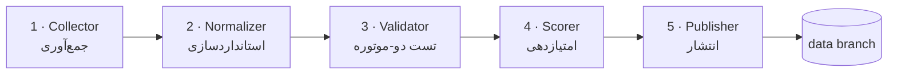

# معماری آریستون

> Five-stage pipeline · Architecture reference

## نمای کلی

آریستون یک خط‌لوله‌ی پنج‌مرحله‌ای است که تماماً داخل GitHub Actions اجرا می‌شود — بدون هیچ سرور، بدون هیچ هزینه‌ی ثابت:



## مراحل

| # | مرحله | ورودی | خروجی | وضعیت |
|---|---|---|---|---|
| 1 | **Collector** | `pipeline/sources.json` | متن خام منابع + URI ها | ✅ فعال |
| 2 | **Normalizer** | URI های خام | URI های کانونی + کلید هویت سرور | ✅ فعال |
| 3 | **Validator** | URI های یکتا | تأخیر واقعی + وضعیت زنده/مرده | ✅ فعال |
| 4 | **Scorer** | نتایج تست + تاریخچه | امتیاز ۰–۱۰۰ + رده‌بندی Gold/Silver/Bronze | ✅ فعال |
| 5 | **Publisher** | امتیازها | فایل‌های چندفرمته + کانفیگ‌های کلاینت + README زنده | ✅ فعال |

## چرا دو موتور تست؟

| موتور | پوشش پروتکل | نکته |
|---|---|---|
| **xray-core** | VMess · VLESS · Trojan · Shadowsocks (شامل Reality، Vision، XHTTP، HTTPUpgrade، gRPC) | استاندارد طلایی برای پروتکل‌های TCP/TLS |
| **sing-box** | Hysteria2 · TUIC · Shadowsocks با plugin (obfs / v2ray-plugin) | خانواده‌ی QUIC/UDP — **xray اصلاً پشتیبانی نمی‌کند** |

اکثر مخازن مشابه فقط xray دارند و گره‌های QUIC را «کورکورانه» منتشر می‌کنند؛ آریستون هر دو موتور را در هر اجرا دانلود و اجرا می‌کند (نسخه‌های pinned = تکرارپذیری). SSR پشتیبانی نمی‌شود (از sing-box 1.12+ حذف شده) و به‌عنوان `unsupported` شمرده می‌شود.

## Validator — تست واقعی هر گره

هر گره در چهار گام زنده‌سنجی می‌شود (`pipeline/validate.py`):

1. **ROUTE** — انتخاب موتور بر اساس پروتکل و transport
2. **CONFIG** — تولید config یک‌بارمصرف: inbound SOCKS روی `127.0.0.1` روت‌شده به outbound همان گره
3. **BOOT** — اجرای موتور به‌صورت subprocess و انتظار تا باز شدن پورت SOCKS (حداکثر ۲ ثانیه)
4. **PROBE** — گفتگوی خام SOCKS5 (RFC 1928، دست‌نویس، stdlib-only) و گرفتن `/generate_204` از چرخش سه هدف (gstatic / cloudflare / miui). تأخیر = زمانِ رسیدن خط وضعیت

ملاحظات ظرفیت:

- هر گره سقف ~۴.۵ ثانیه (`ARISTON_TIMEOUT`)؛ گره‌های مرده همان‌جا قطع می‌شوند
- اجرای همزمان با `ThreadPoolExecutor` (پیش‌فرض ۲۴ محلی، ۷۲ روی CI)
- بودجه‌ی واقعی: کل ۸–۹ هزار گره ≈ **۳ تا ۱۰ دقیقه** روی runner عمومی
- اگر باینری موتورها موجود نباشد، اعتبارسنجی به‌تمامی skip می‌شود و خروجی master بدون tier ها منتشر می‌گردد (شکست نرم)

## تاریخچه و امتیازدهی

- `results.json` روی شاخه‌ی `data` نگه‌داری می‌شود و ابتدای هر اجرا بارخوانی می‌شود:
  `ok/fail` تجمعی، EMA نرخ موفقیت، `last_ok`، تأخیر آخرین تست
- امتیاز = `0.40×latency + 0.30×success + 0.15×freshness + 0.15×protocol` (مؤلفه‌ی ناموجود حذف و وزن‌ها باز-normalize می‌شوند)
- رده‌ها: **Gold ≥ 80 · Silver ≥ 55 · Bronze زیر آن** — فقط گره‌های زنده وارد tier files می‌شوند
- تاریخچه‌ی قدیمی‌تر از ۱۴ روز prune می‌شود (سقف سخت ۵۰ هزار ردیف)

## استراتژی انتشار: شاخه‌ی `data`

- خروجی‌ها به شاخه‌ی `data` با **force-push** می‌روند → در هر لحظه فقط یک snapshot وجود دارد
- تاریخچه‌ی `main` هرگز رشد نمی‌کند (بعضی مخازن به ۲۳هزار کامیت رسیده‌اند!)
- `main` فقط کد + README است؛ `data` فقط داده — جدایی کامل نگرانی‌ها
- فایل‌های مصرف‌کننده: `nodes.txt` (همه‌ی یکتاها) · `validated.txt` (فقط زنده‌ها، مرتب بر اساس امتیاز) · `gold.txt` / `silver.txt` · `by-protocol/*` · نسخه‌های `.b64` همه

## کانفیگ‌های کلاینت (فاز ۲)

`pipeline/exports.py` از لیست زنده‌ها (مرتب بر اساس امتیاز) دو کانفیگ کامل می‌سازد:

- **`mihomo.yaml`** — کانفیگ کامل Mihomo (Clash.Meta): گروه `Ariston` (انتخاب دستی) + `Auto` (url-test بین ۱۲۰ تای اول) + پروکسی‌های کامل با پشتیبانی vless/vmess/trojan/ss/ssr/hysteria2/tuic
- **`singbox.json`** — کانفیگ کامل sing-box: inbound از نوع mixed روی پورت ۲۰۸۰، سلکتور `Ariston` + urltest `Auto` و یک outbound برای هر گره

فیلترهای سخت‌گیرانه قبل از خروجی: کلید Reality نامعتبر (X25519 بدفرم)، fingerprint های غیر-utls، flow های غیر از vision، و transport های پشتیبانی‌نشده — اینها حذف می‌شوند تا کانفیگ هرگز توسط کلاینت reject نشود. هر دو فایل با خود باینری‌ها تست شده‌اند (`sing-box check` پاس کامل).

## README زنده

آمار هر اجرا بین نشانگرهای `<!-- stats:start/end -->` در هر دو README تزریق می‌شود. برای آنکه تاریخچه‌ی `main` باد نکند، کامیت آمارِ ربات (اگر HEAD باشد) با `--amend` بازنویسی و با `--force-with-lease` push می‌شود — یعنی در هر لحظه حداکثر یک کامیتِ «آمار زنده» روی main وجود دارد و کامیت‌های انسانی هرگز بازنویسی نمی‌شوند.

## کانونی‌سازی (Canonicalization)

دو منبع معمولاً همان گره را با نام‌ها یا ترتیب پارامترهای متفاوت منتشر می‌کنند. برای حذف تکراری واقعی:

- scheme و host به حروف کوچک؛ پورت عددی یکدست؛ هاست IPv6 داخل براکت
- نام نمایشی حذف می‌شود (`ps` در vmess، `#fragment` در URI ها، remarks در ssr)
- پارامترهای query مرتب می‌شوند
- vmess از JSON با کلیدهای مرتب دوباره encode می‌شود
- حذف تکراری در دو سطح: **hash کامل کانونی** و سپس **هویت سرور** (`scheme|host|port|net|security`)

نتیجه در اجرای واقعی: **۱۷,۲۲۳ خام → ۸,۷۷۴ یکتا (۴۹٪ تکراری!)**

## اجرای محلی

```bash
# نیازی به نصب هیچ بسته‌ای نیست — فقط Python ≥ 3.10
python -m pipeline.main collect            # فقط جمع‌آوری + استانداردسازی
python -m pipeline.main run                # + تست زنده + امتیازدهی (نیاز به باینری موتورها)
python -m pipeline.main run --no-validate  # تست زنده را رد کن

# مسیر باینری‌ها و ظرفیت با env کنترل می‌شود:
#   ARISTON_XRAY / ARISTON_SINGBOX / ARISTON_CONCURRENCY / ARISTON_TIMEOUT / ARISTON_MAX_NODES
# خروجی‌ها در dist/
```
